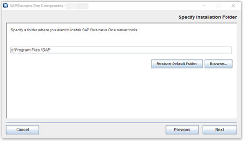
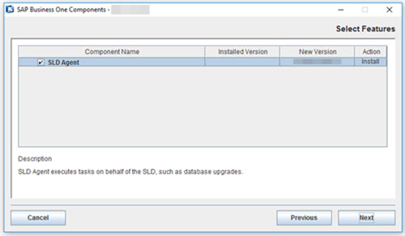
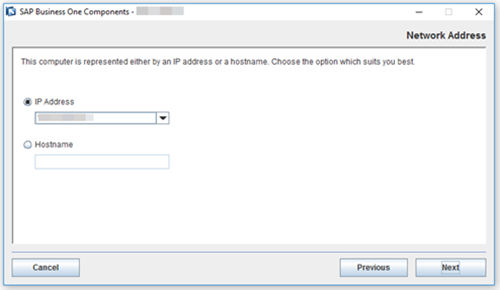
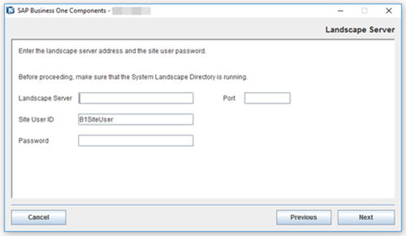
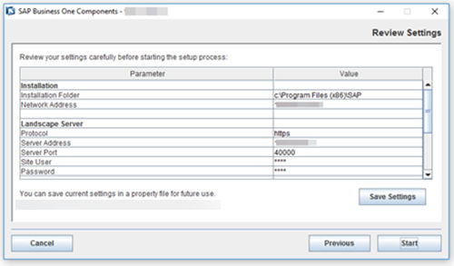
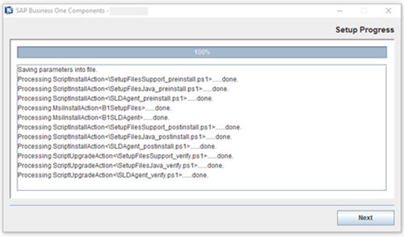
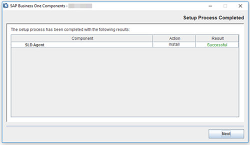
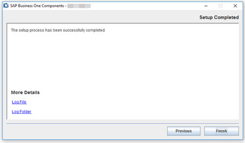

# Registering Logical Machines and Installing the SLD Agent with the Wizard

## Registering and Unregistering Logical Machines

A machine is registered to the System Landscape Directory (SLD) only when the SLD Agent is locally installed on it and connected to the SLD.

> **Note**
>
> The SLD Agent is a key component of centralized deployment. The SLD Agent service executes tasks on behalf of the System Landscape Directory, such as performing database deployment and upgrades, remote installation and upgrades of SAP Business One client and DI API. You can manually install the SLD Agent service using the **Components Setup Wizard**. For more information, see [Manually Installing SLD Agent Service](#manually-installing-sld-agent-service) [page 165].

A logical machine is unregistered when you uninstall the SLD Agent from the machine locally.

## Manually Installing SLD Agent Service

You can manually install the SLD Agent service on the logical machines by using the following methods:

- [Wizard Installation](#wizard-installation) [page 166]
- [Silent Installation](sld-agent-silent-installation.md) [page 170]

**Prerequisites**

- You have installed the SLD.
- You have installed Windows PowerShell 5 or the higher version on the machine on which you are performing the installation.
- You have administrator rights on the machine on which you are performing the installation.

> **Note**
>
> For more information about possible installer issues related to the user account control (UAC) in Microsoft Windows operating systems, see SAP Note [1492196](https://me.sap.com/notes/1492196).

## Wizard Installation

**Procedure**

1. Navigate to the installation folder for the SLD Agent service (default path: `\Packages.x64\ComponentsWizard`)
2. Select one of the executable files to run:
   - *Install.exe*: enables only GUI mode installation
   - *Install-console.exe*: enables both GUI mode and silent mode installation. When you start running this file, both a GUI screen and a separate console window are opened. The console output contains the full file path to the actual log file.
3. In the *Setup Wizard* window, select *Installation and Upgrade* and choose *Next*.
4. In the *Specify Installation Folder* window, specify a folder where you want to install the SLD Agent and choose *Next*.

   Figure: The Specify Installation Folder window of the SAP Business One Components wizard.

   

5. In the *Select Features* window, select *SLD Agent* and choose *Next*.

   Figure: The Select Features window with SLD Agent selected.

   

6. In the *Network Address* window, select an IP address, or use the hostname, as the network address for the selected components and choose *Next*.

   Figure: The Network Address window with IP Address and Hostname options.

   

7. In the *Landscape Server* window, enter the landscape server address and the landscape administrator password and choose *Next*.

   > **Note**
   >
   > The installation process can only be continued by entering the credentials of the `B1SiteUser` account. Other landscape administrators do not have the permissions to perform this operation.

   Figure: The Landscape Server window.

   

   The window asks you to make sure the System Landscape Directory is running, and has the fields *Landscape Server*, *Port*, *Site User ID* (prefilled with `B1SiteUser`) and *Password*.

8. In the *Review Settings* window, review your settings carefully before proceeding to execute the installation. If you need to change your settings, choose *Previous* to go to the relevant windows; otherwise, choose *Start* to begin the installation.

   Figure: The Review Settings window, with the Save Settings button.

   

   The window lists parameters and values in a table. Installation: *Installation Folder* and *Network Address*. Landscape Server: *Protocol* (`https`), *Server Address*, *Server Port* (`40000`), *Site User* and *Password* (both masked as `****`). *Save Settings* is below the table, and *Cancel*, *Previous* and *Start* are at the bottom.

   > **Note**
   >
   > You can save current settings to a property file for future reuse by choosing *Save Settings*. The Site User ID and password are excluded from export and must therefore be configured manually.

9. In the *Setup Progress* window, when the progress bar displays 100%, choose *Next* to finish the installation.

   Figure: The Setup Progress window at 100%.

   

   The progress bar shows 100%. The log below it lists each step as done: saving parameters into file, then the install actions (`SetupFilesSupport_preinstall.ps1`, `SetupFilesJava_preinstall.ps1`, `SLDAgent_preinstall.ps1`, the `B1SetupFiles` and `B1SLDAgent` MSI installs, the three `_postinstall.ps1` scripts) and the three `_verify.ps1` upgrade scripts.

10. In the *Setup Process Completed* window, review the installation results showing *SLD Agent* has been successfully installed.

    Figure: The Setup Process Completed window showing the SLD Agent installed successfully.

    

11. To exit the wizard, choose *Finish*.

    Figure: The Setup Completed window with the Log File and Log Folder links and the Finish button.

    
