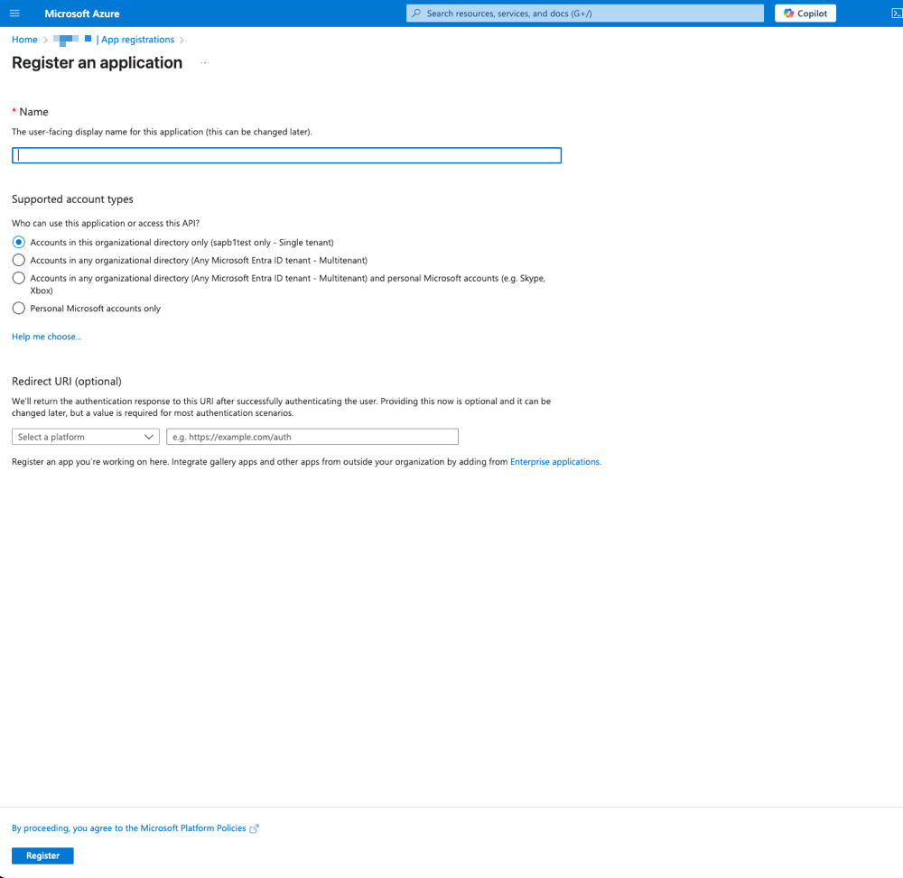
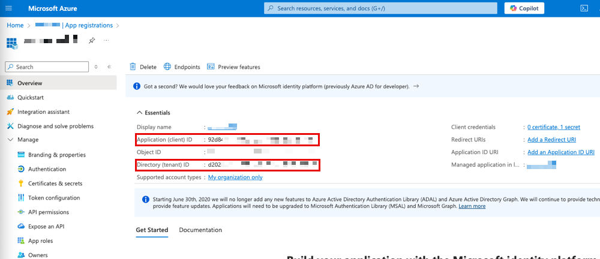
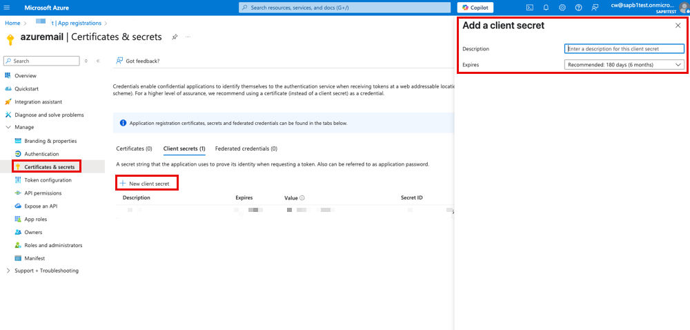
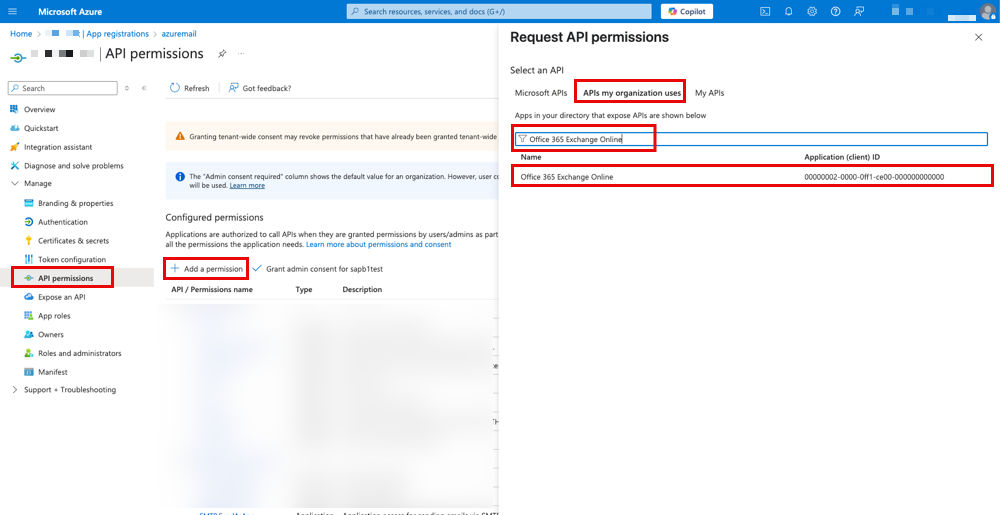
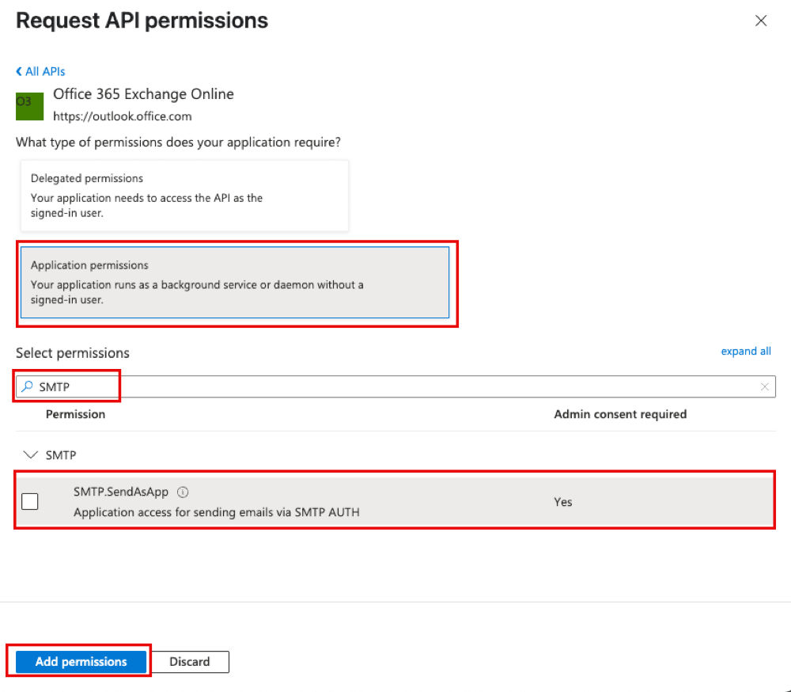
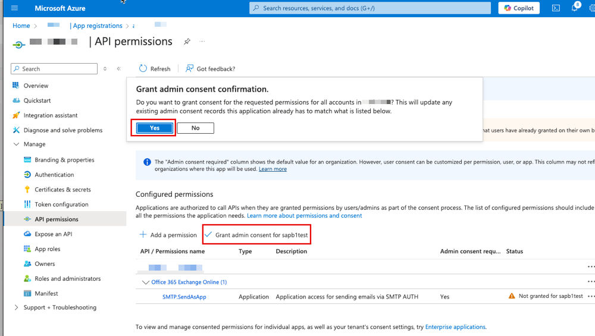
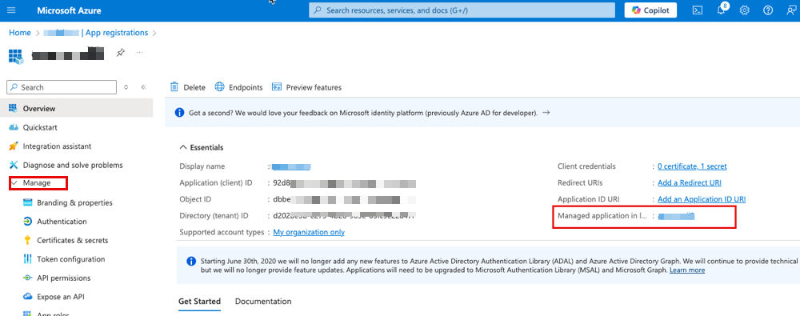
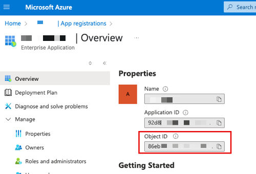

# SBO Mailer: Microsoft Entra ID application and Exchange service principal

- [Registering an Application on Microsoft Entra ID](#registering-an-application-on-microsoft-entra-id)
- [Registering the Service Principal in Exchange Server](#registering-the-service-principal-in-exchange-server)

## Registering an Application on Microsoft Entra ID

**Prerequisites**

You have a Microsoft Entra ID account that has an active subscription.

**Context**

If you intend to choose the authentication method *OAuth 2.0 for Microsoft 365* for use with the SBO Mailer, you need to register an application on Microsoft Entra ID before configuring the SBO Mailer in SAP Business One.

**Procedure**

1. Sign in to the [Azure Portal](https://portal.azure.com/).
2. Search for and select *Microsoft Entra ID*.
3. Under *Manage*, select *App registrations* → *New registration*.
4. In the *Register an application* window, specify the following information and then choose *Register*：
   1. Enter a display *Name* for your application. You can change the display name at any time.
   2. Under *Supported account types*, specify who can use the application. You can select the default type.
   3. For the *Redirect URI (optional)*, you can select *Web* and enter the redirect URI based on your needs or leave it blank.

   Figure: The Register an application window.

   

   The page has a required *Name* field; *Supported account types* with four options (single tenant only, preselected; any Microsoft Entra ID tenant - Multitenant; Multitenant plus personal Microsoft accounts; personal Microsoft accounts only); an optional *Redirect URI* with a platform dropdown and a URI field; and the *Register* button at the bottom.

   You can now see the new application under *All application*.
5. Under *All applications*, choose the application that you just registered and record the values of the *Application (client) ID* and *Directory (tenant) ID*. They will be used later when registering the service principal in the Exchange Server. The value of the *Application (client) ID* will also be used when configuring the SBO Mailer in SAP Business One client and the Job Service Web page.

   Figure: The registered application overview with the Application (client) ID and Directory (tenant) ID highlighted.

   
6. Add a new client secret for the registered application:
   1. In the left menu, choose *Manage* > *Certificates & secrets*.
   2. In the right panel, choose *New client secret*.
   3. In the *Add a client secret* panel, enter a description for the client secret and define the valid period.

   Figure: The Certificates & secrets page with the Add a client secret panel.

   

   You can now see the new client secret in the *Client secrets* list. Record the value of the client secret. It will be used later when configuring the SBO Mailer in the SAP Business One client and the Job Service Web page.
7. Add API permissions for the registered application:
   1. In the left menu, choose *Manage* > *API permissions*.
   2. In the right panel, choose *Add a permission*.
   3. In the *Request API permissions* panel, choose *APIs my organization uses* and search for `Office 365 Exchange Online`.
   4. Choose *Office 365 Exchange Online* from the list.

   Figure: The Request API permissions panel with Office 365 Exchange Online in the list.

   

   5. Choose *Application permissions* and search for `SMTP`.
   6. Select the *SMTP SendAsApp* checkbox and choose *Add permissions*.

   Figure: The SMTP SendAsApp permission selected in the Request API permissions panel.

   

   7. Choose *Grant admin consent for <user account>*.

   Figure: The API permissions page with the Grant admin consent option.

   

   Under *Configured permissions*, *Office 365 Exchange Online* lists `SMTP.SendAsApp` (type Application, admin consent required: Yes) with status *Not granted*. After *Grant admin consent* is chosen, a *Grant admin consent confirmation* dialog asks for confirmation; choose *Yes*.

   The status is changed to *Granted for <user account>*
8. In the left menu, choose *Overview*. In the right panel, in the *Essentials* area, choose the link to *Managed application in local directory*.

   Figure: The Essentials area with the link to Managed application in local directory.

   
9. Record the value of the *Object ID*. It will be used later when registering the service principal in the Exchange Server.

   Figure: The enterprise application Overview page with the Object ID highlighted.

   

## Registering the Service Principal in Exchange Server

**Prerequisites**

1. You have registered an application on Microsoft Entra ID.
2. You have recorded the values of the *Application (client) ID* and *Directory (tenant) ID* for the registered application.
3. You have recorded the value of the *Object ID* for the enterprise application.

**Context**

If you intend to choose the authentication method *OAuth 2.0 for Microsoft 365* for use with the SBO Mailer, you need to register the service principal in the Exchange Server before configuring the SBO Mailer in SAP Business One.

**Procedure**

1. Launch Windows PowerShell.
2. Execute the following commands:

```powershell
Install-Module -Name ExchangeOnlineManagement

Import-module ExchangeOnlineManagement

Connect-ExchangeOnline -Organization <Tenant ID of the registered application>

New-ServicePrincipal -AppId <Client ID of the registered application> -ObjectId
<Object ID of the enterprise application>

Add-MailboxPermission -Identity "<Email address>" -User <Object ID of the
enterprise application> -AccessRights FullAccess
```

   Ensure that `<Email address>` specified here matches the one used when configuring the SBO Mailer in the SAP Business One client and on the Job Service web page. The account `<Email address>` must have a license with Office 365 Exchange Online and SMTP AUTH enabled.

   If you intend to send emails from another account, the account should grant the *Send As* permission to the account `<Email address>`. otherwise an error may occur.

> **Example**
>
> If the email account `company@abcd.com` is configured for the SBO Mailer and you want another account `sales@abcd.com` to send emails, the *Send As* permission must be granted to `company@abcd.com` from the account `sales@abcd.com` in the Exchange admin center.
>
> For more information, see [Fix issues with printers, scanners, and LOB apps that send email using Microsoft 365](https://learn.microsoft.com/en-us/troubleshoot/exchange/email-delivery/fix-issues-with-printers-scanners-and-lob-applications-that-send-email-using-off#fix-issues-with-smtp-auth-client-submission)
