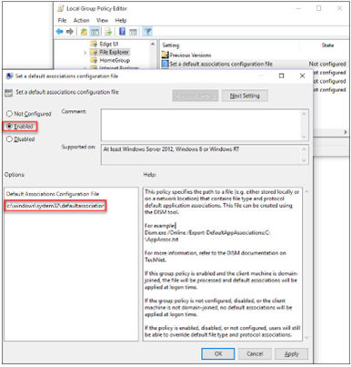

# Web Client: Setting the Default Browser with Group Policy

After the installation, to start working with the Web client on Windows, ensure that you set Google Chrome or Mozilla Firefox as your default Web browser. If your devices are Windows domain-joined, we recommend that the administrator centrally set the default browser using Group Policy, as follows:

1. According to the Web browser you intend to use, create and store a default application association XML file locally or on a network share.
  - For Google Chrome:

```xml
<?xml version="1.0" encoding="UTF-8"?>
<DefaultAssociations>
  <Association Identifier=".htm" ProgId="ChromeHTML"
ApplicationName="Google Chrome" />
  <Association Identifier=".html" ProgId="ChromeHTML"
ApplicationName="Google Chrome" />
  <Association Identifier="http" ProgId="ChromeHTML"
ApplicationName="Google Chrome" />
  <Association Identifier="https" ProgId="ChromeHTML"
ApplicationName="Google Chrome" />
</DefaultAssociations>
```

- For Mozilla Firefox:

```xml
<?xml version="1.0" encoding="UTF-8"?>
<DefaultAssociations>
<Association Identifier=".htm" ProgId="FirefoxHTML"
ApplicationName="Firefox" />
<Association Identifier=".html" ProgId="FirefoxHTML"
ApplicationName="Firefox" />
<Association Identifier="http" ProgId="FirefoxHTML"
ApplicationName="Firefox" />
<Association Identifier="https" ProgId="FirefoxHTML"
ApplicationName="Firefox" />
</DefaultAssociations>
```

2. Set the default browser using Group Policy:
  1. Open your Group Policy editor and go to the setting: `Computer Configuration\Administrative Templates\Windows Components\File Explorer\Set a default associations configuration file`.
  2. Click *Enabled*, and then in the *Options* area, enter the location to your default associations configuration file.
  3. If this setting is turned on and one device is domain-joined, this file is processed, and default associations are applied at logon. If this setting is not configured or is turned off, or if a device is not domain-joined, no default associations are applied at logon.

Figure: The Group Policy editor with the setting "Set a default associations configuration file" enabled and the location of the configuration file entered.



The *Set a default associations configuration file* dialog has *Enabled* selected, and the *Default Associations Configuration File* option holds a path under `c:\windows\system32\` (the file name is cut off in the screenshot).

On each Windows machine, you can individually change the default browser under *Settings* > *Default apps* > *Web browser*.

> **Note**
>
> If your SAP Companion fails to display help content due to a CORS error, it is recommended that you upgrade your SAP Business One to version 10.0 FP 2602. For more information, see SAP Note 3702859 (https://me.sap.com/notes/3702859).
