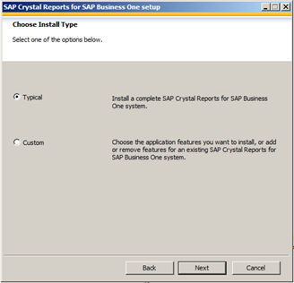

# Installing SAP Crystal Reports

SAP Crystal Reports, version for the SAP Business One application provides integration with the SAP Crystal Reports software, which allows you to create, view, and manage reports and layouts.

Different versions of SAP Business One support their corresponding SAP Crystal Reports (CR) runtime in addition to different versions of CR for SAP Business One. To make sure that there are no shutdowns or other inconsistency issues, always check your environment and verify that the supported version of CR for SAP Business One is in use. For more information about SAP Crystal Reports for SAP Business One, see SAP Notes 2329487 (https://me.sap.com/notes/2329487) and 3682323 (https://me.sap.com/notes/3682323).

To use SAP Crystal Reports, version for the SAP Business One application, perform the following operations:

1. Install SAP Crystal Reports, version for the SAP Business One application.
2. Run the SAP Crystal Reports integration script. This step ensures that SAP Business One data sources are available in the application.

> **Note**
>
> To use SAP Crystal Reports, version for the SAP Business One application, you must install Microsoft .NET Framework 4.8 on the server as well as on the client workstations.

For more information about SAP Crystal Reports, version for the SAP Business One application, see *How to Work with SAP Crystal Reports in SAP Business One* on SAP Help Portal (https://help.sap.com/viewer/p/SAP_BUSINESS_ONE_PRODUCT_LINE).

## Installing SAP Crystal Reports, version for the SAP Business One Application

**Prerequisites**

> **Note**
>
> Certain runtime files are no longer used for CR-related runtime functionality. To prevent compatibility issues, starting with 10.0 FP 2608, the following files are no longer included in new installations:
>
> - `BOERuntime_x86.exe`
> - `BusinessobjectsRuntime32.zip`
>
> If these files are still needed for specific use cases, they can be obtained from older SAP Business One versions available in the SAP Service Marketplace.
>
> This change is only applicable to new installations. When upgrading from versions lower than 10.0 FP 2608 to 10.0 FP 2608 or higher, the files that were present from earlier releases will not be removed and will remain available.

- You have downloaded the installation package of SAP Crystal Reports, version for the SAP Business One application from the SAP Business One Software Download Center on SAP Support Portal at https://support.sap.com/b1software.
- The operating system of the computer on which you want to install SAP Crystal Reports for SAP Business One is Windows 7 SP1 or higher.
- If you already have SAP Crystal Reports installed on your computer, uninstall this software. You will also be prompted to uninstall it during the installation procedure.

**Procedure**

1. Navigate to the root folder of the product package and run the `setup.exe` file.
2. In the *SAP Crystal Reports for SAP Business One setup* window, select a setup language and choose *OK*.
3. The *Prerequisites check* window appears. If you have fulfilled all critical prerequisites, you can continue with the installation; otherwise, follow the instructions in the wizard to resolve any issues before proceeding.
4. In the welcome window, choose *Next*.
5. In the *License Agreement* window, read the software license agreement, select the radio button *I accept the License Agreement*, and then choose *Next*.
6. In the *Specify the Destination Folder* window, specify a folder where you want to install the software.
7. In the *Choose Language Packs* window, select the checkboxes of the languages you want to install and choose *Next*.
8. In the *Choose Install Type* window, select one of the following installation types and choose *Next*:
    - *Typical*: Installs all application features. For a typical installation, proceed to step 9.
    - *Custom*: Allows you to do the following:
        - Select features that you want to install. If you have installed SAP Crystal Reports, version for the SAP Business One application, you can select the *Custom* install type to add or remove features.
        - Select whether or not you want to receive the web update service
        - Check the disk cost of the installation

    Figure: The Choose Install Type window of the SAP Crystal Reports for SAP Business One setup.

    

    > **Note**
    >
    > If you have done one of the following, the *Browse* button is inactive because a destination folder already exists:
    >
    > - You have already installed SAP Business One; that is, before installing SAP Crystal Reports, version for the SAP Business One application.
    > - You have already installed the SAP Crystal Reports viewer. For example, this may be installed automatically when you install the SAP Business One client.

9. In the *Select Features* window, select the features you would like to install and choose *Next*.

    The icons in the feature tree indicate whether the feature and its sub-features will be installed, as follows:

    - A white icon means that the feature and all its sub-features will be installed.
    - A shaded icon means that the feature and some of its sub-features will be installed.
    - A yellow 1 means that the feature will be installed when required (installed on demand).
    - A red X means that the feature or sub-feature is either unavailable or will not be installed.

    SAP Crystal Reports, version for the SAP Business One application uses an "install on-demand" technology for some of its features. As a result, the first time a particular feature is used after being installed, there may be an extra wait for the "install on-demand" to complete. This behavior will affect new installations only once and will not occur when features are restarted.

    To check how much disk space is required for the installation of selected features, choose *Disk Cost*.

10. In the *Web Update Service Option* window, you can disable the web update service by selecting the *Disable Web Update Service* checkbox. We recommend, however, that you enable the update service to stay aware of updates that can help you enhance your SAP Crystal Reports. Choose *Next* to proceed.

11. In the *Start Installation* window, choose *Next*.

    The *Crystal Reports for SAP Business One Setup* window appears.

12. When the installation is complete, the *Success* window appears. To exit the installation wizard, choose *Finish*.

**Next Steps**

Ensure that you also have the 32-bit DI API Legacy Package installed on your workstation; otherwise, you cannot connect to SAP Business One data sources or use the *Add-ins* menu to connect to SAP Business One.

## Running the Integration Package Script

**Context**

To make the SAP Business One data sources and the *Add-ins* menu available in the SAP Crystal Reports designer, run the SAP Business One Crystal Reports integration script. The SAP Business One tables are organized according to the modules in the SAP Business One *Main Menu*.

**Procedure**

1. In the SAP Business One product or upgrade package, locate the `…Packages.x64\SAP CRAddin Installation` folder and double-click the `SAP Business One Crystal Report Integration Package.exe` file.
2. After the installation is complete, choose *Finish* to exit the wizard.
