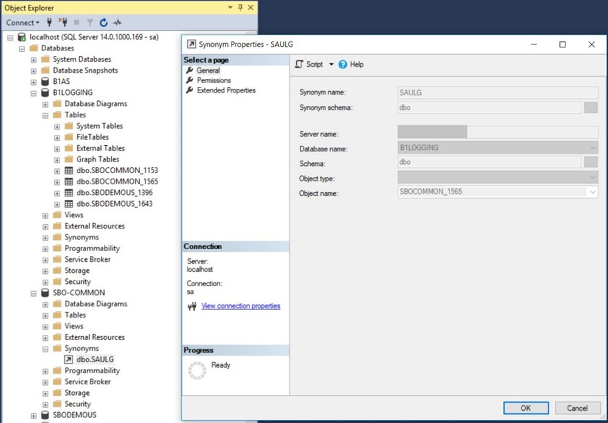

# Database Access Control for Audit Logs (reader role and user)

This section shows you how to create an audit log reader to read the audit logs of SAP Business One in the Microsoft SQL Server, and how to trace the audit log reader's login and read activities in the Microsoft SQL Server.

For more information about Microsoft SQL Server authentication access and audit, see the following documentations on Microsoft Documentation:

- [MS SQL Server Authentication Access How-To Guide](https://learn.microsoft.com/en-us/sql/relational-databases/security/authentication-access/create-a-login?view=sql-server-ver16)
- [MS SQL Server Authentication Access Concept Guide](https://learn.microsoft.com/en-us/sql/relational-databases/security/authentication-access/getting-started-with-database-engine-permissions?view=sql-server-ver16)
- [MS SQL Server Audit How-To Guide](https://learn.microsoft.com/en-us/sql/relational-databases/security/auditing/create-a-server-audit-and-server-audit-specification?view=sql-server-ver16)
- [MS SQL Server Audit Concept Guide](https://learn.microsoft.com/en-us/sql/relational-databases/security/auditing/sql-server-audit-database-engine?view=sql-server-ver16)

## Creating the Audit Log Reader Role

**Procedure**

1. Open the SQL Server Management Studio and log in with the database administrator account.
2. In the *Object Explorer* window, connect to an instance of the Database Engine.
3. On the standard bar, select *New Query*.
4. In the *Query* window, execute the following command:

```sql
USE <company_database>;
CREATE ROLE <role_name>;
GRANT SELECT ON OBJECT::dbo.CAULG TO <role_name>;
USE [SBO-COMMON];
CREATE ROLE <role_name>;
GRANT SELECT ON OBJECT::dbo.SAULG TO <role_name>;
USE B1LOGGING;
CREATE ROLE <role_name>;
GRANT SELECT ON OBJECT::dbo.SBOCOMMON_<common_ID> TO <role_name>;
GRANT SELECT ON OBJECT::dbo.<company_database>_<company_name> TO <role_name>
```

> **Example**
>
> For example, if `<company_database>` is `SBODEMOUS` and `<role_name>` is `AUDIT_LOG_READER_ROLE`, you need to enter the following command:
>
> ```sql
> USE SBODEMOUS;
> CREATE ROLE AUDIT_LOG_READER_ROLE;
> GRANT SELECT ON OBJECT::dbo.CAULG TO AUDIT_LOG_READER_ROLE;
> USE [SBO-COMMON];
> CREATE ROLE AUDIT_LOG_READER_ROLE;
> GRANT SELECT ON OBJECT::dbo.SAULG TO AUDIT_LOG_READER_ROLE;
> USE B1LOGGING;
> CREATE ROLE AUDIT_LOG_READER_ROLE;
> GRANT SELECT ON OBJECT::dbo.SBOCOMMON_<common_ID> TO AUDIT_LOG_READER_ROLE;
> GRANT SELECT ON OBJECT::dbo.SBODEMOUS_<company_ID> TO
> AUDIT_LOG_READER_ROLE;
> ```

> **Note**
>
> Sometimes, the original table in the `B1LOGGING` database cannot be located by the database name, as there might be multiple tables with the same database prefix but different ids. In this case, you need to choose the synonyms table in the `SBO-COMMON` or company database, and then select *Properties* to find the original table in *Object name*.

Figure: The original table of the synonym, shown under Object name in its properties.



The screenshot shows SQL Server Management Studio with the *Synonym Properties - SAULG* window open on the *General* page: synonym name `SAULG`, schema `dbo`, database name `B1LOGGING`, schema `dbo`, object name `SBOCOMMON_1565`. Object Explorer shows the `dbo.SAULG` synonym under `SBO-COMMON` and the tables `SBOCOMMON_1153`, `SBOCOMMON_1565`, `SBODEMOUS_1396` and `SBODEMOUS_1643` under `B1LOGGING`.

## Creating the Audit Log Reader and Grant the Role

**Context**

Perform the following steps to create the audit log reader and grant the role to the audit log reader.

**Procedure**

1. Open the SQL Server Management Studio and log in with the database administrator account.
2. In the *Object Explorer* window, connect to an instance of the Database Engine.
3. On the standard bar, select *New Query*.
4. In the *Query* window, execute the following command:

```sql
CREATE LOGIN <audit_log_reader_name> WITH PASSWORD = '<password>';
USE <company_database>;
CREATE USER <audit_log_reader_name> FOR LOGIN <audit_log_reader_name>;
ALTER ROLE <audit_log_reader_name> ADD MEMBER <audit_log_reader_name>;
USE [SBO-COMMON];
CREATE USER <audit_log_reader_name> FOR LOGIN <audit_log_reader_name>;
ALTER ROLE <audit_log_reader_name> ADD MEMBER <audit_log_reader_name>;
USE B1LOGGING;
CREATE USER <audit_log_reader_name> FOR LOGIN <audit_log_reader_name>;
ALTER ROLE <audit_log_reader_name> ADD MEMBER <audit_log_reader_name>
```

> **Example**
>
> For example, if `<password>` is `Password1`, `<company_database>` is `SBODEMOUS` and `<audit_log_reader_name>` is `AUDIT_LOG_READER`, you need to enter the following command:
>
> ```sql
> CREATE LOGIN AUDIT_LOG_READER WITH PASSWORD = 'Password1';
> USE SBODEMOUS;
> CREATE USER AUDIT_LOG_READER FOR LOGIN AUDIT_LOG_READER;
> ALTER ROLE AUDIT_LOG_READER_ROLE ADD MEMBER AUDIT_LOG_READER;
> USE [SBO-COMMON];
> CREATE USER AUDIT_LOG_READER FOR LOGIN AUDIT_LOG_READER;
> ALTER ROLE AUDIT_LOG_READER_ROLE ADD MEMBER AUDIT_LOG_READER;
> USE B1LOGGING;
> CREATE USER AUDIT_LOG_READER FOR LOGIN AUDIT_LOG_READER;
> ALTER ROLE AUDIT_LOG_READER_ROLE ADD MEMBER AUDIT_LOG_READER
> ```
