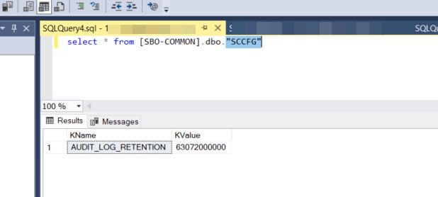

# Retention Period of Audit Logs in the Database

By default, the retention period for an audit log entry in the database is defined as `63072000000` millisecond (730 days). You can customize the retention period in `[SBO-COMMON].dbo."SCCFG"` table in the SQL Server Management Studio. The minimum value must be equal to or greater than `604800000` (1 week) milliseconds.

Figure: The retention value in the SCCFG table.

The query `select * from [SBO-COMMON].dbo."SCCFG"` returns one row: KName `AUDIT_LOG_RETENTION`, KValue `63072000000`.
