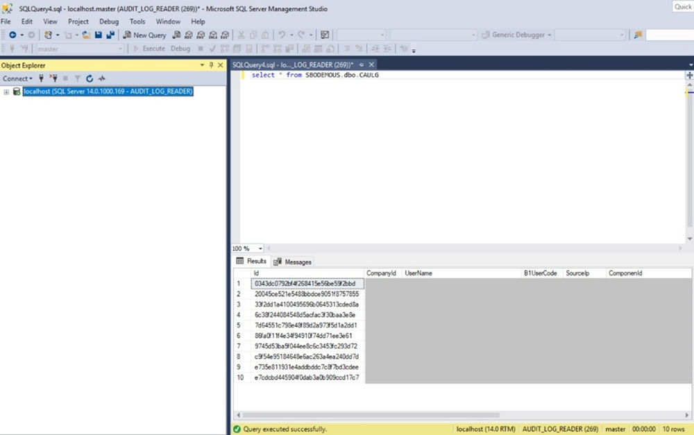
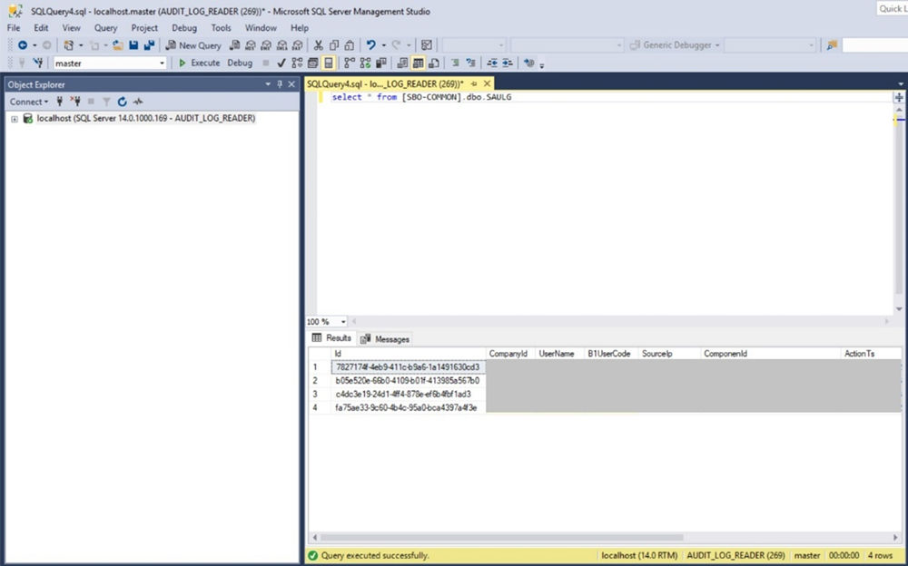

# Checking Audit Logs of SAP Business One

**Context**

After creating and granting the role to the audit log reader, you can now connect to the Microsoft SQL Server with the audit log reader account and access the SAP Business One audit log tables with the read-only authorization.

**Procedure**

1. Open the SQL Server Management Studio and log in with the audit log reader's account (for example, `AUDIT_LOG_READER`).
2. In the *Object Explorer* window, connect to an instance of the Database Engine.
3. On the standard bar, select *New Query*.
4. In the *Query* window, execute one of the following commands to check the audit logs of the company database:

   ```sql
   select * from [B1LOGGING].dbo.<company_database>_<company_ID>
   ```

   or `select * from <company_database>.dbo.CAULG`

   For example, `select * from SBODEMOUS.dbo.CAULG`

   Then you see the results as follows:

   Figure: Query results of select * from SBODEMOUS.dbo.CAULG in SQL Server Management Studio.

   

5. Execute one of the following commands to check the audit logs of the `SBO-COMMON` database:

   ```sql
   select * from [B1LOGGING].dbo.SBOCOMMON_<common_ID>
   ```

   or `select * from [SBO-COMMON].dbo.SAULG`

   For example, `select * from [SBO-COMMON].dbo.SAULG`

   Then you see the results as follows:

   Figure: Query results of select * from [SBO-COMMON].dbo.SAULG in SQL Server Management Studio.

   

> **Note**
>
> The audit log reader has no permission to perform any other operations except reading the audit log tables of SAP Business One.
