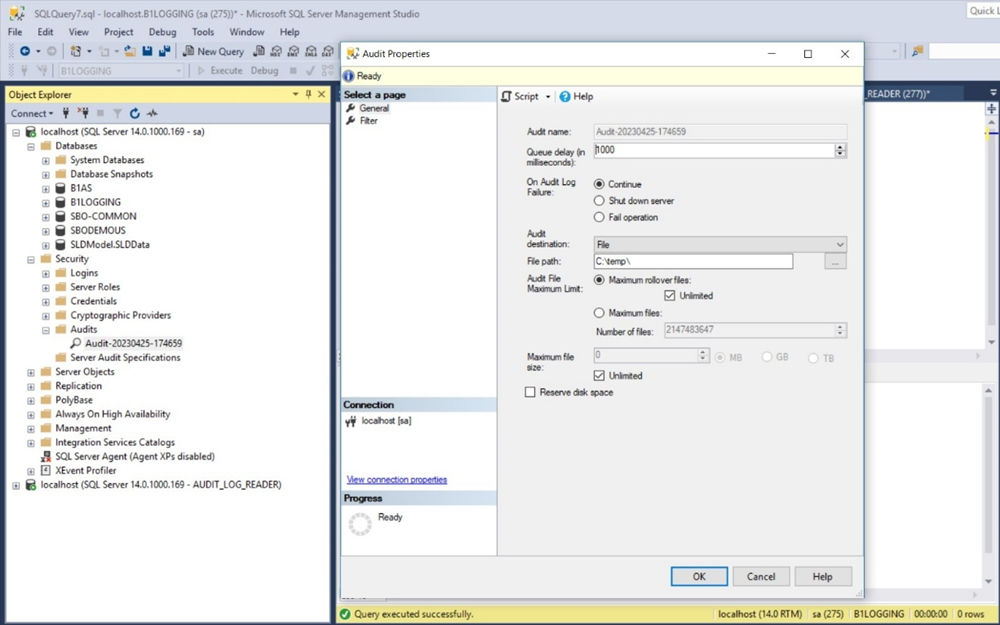
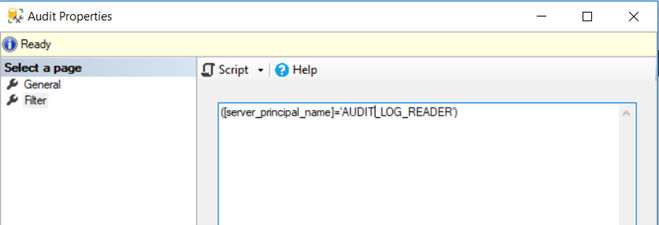
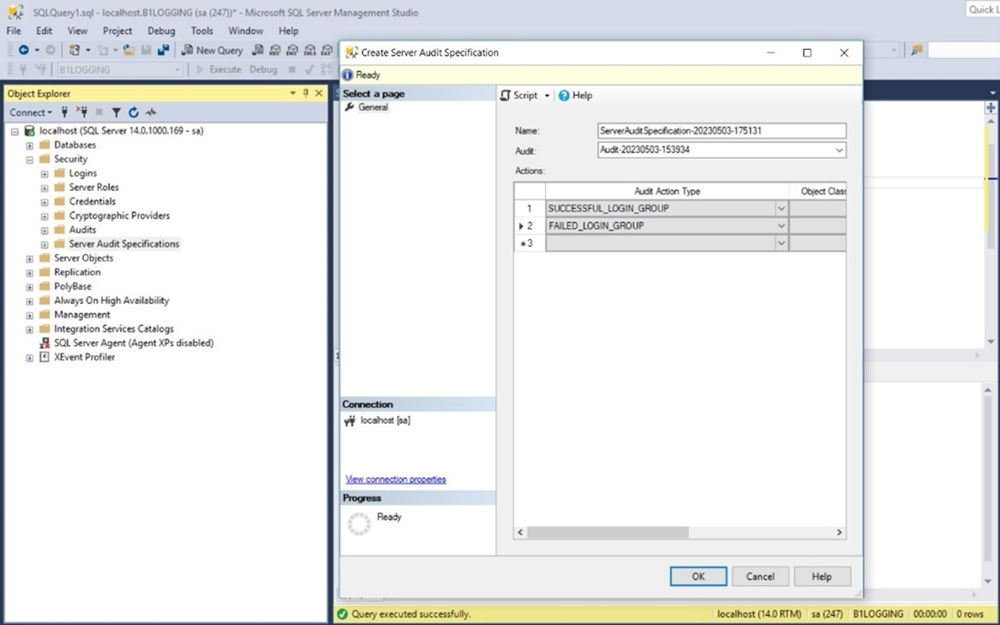
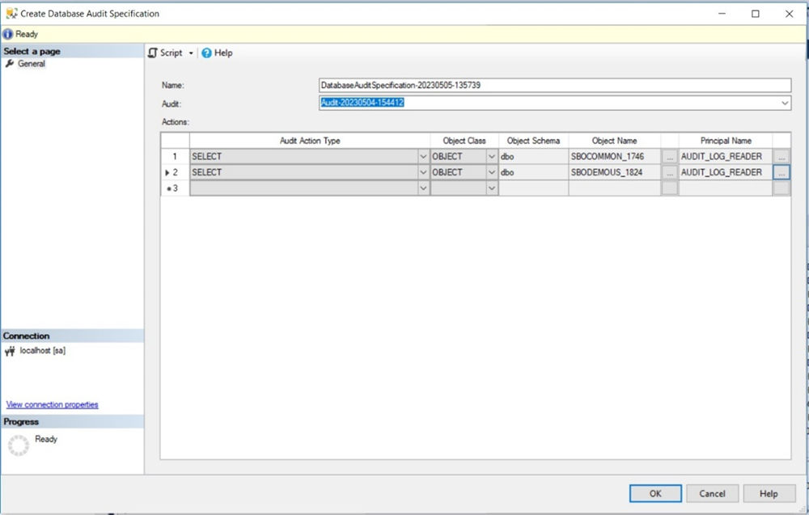
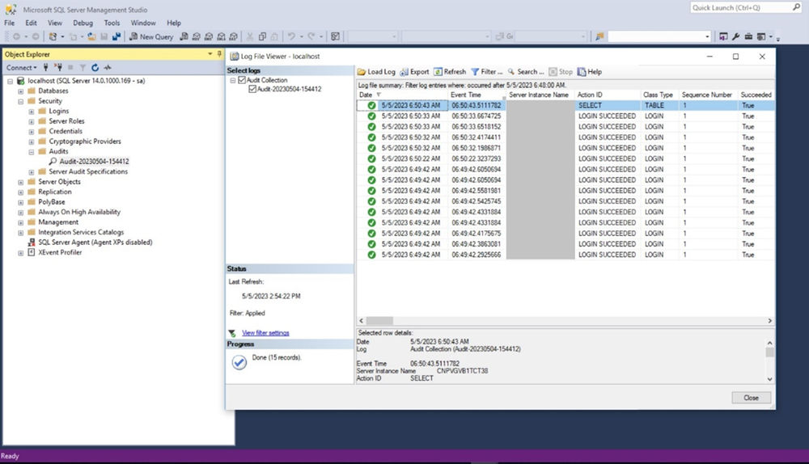

# Tracing the Audit Log Reader's Login and Reading Activities

- [Creating the Audit](#creating-the-audit)
- [Creating Server Audit Specification](#creating-server-audit-specification)
- [Creating Database Audit Specification](#creating-database-audit-specification)
- [Reading the Audit Logs and Activities](#reading-the-audit-logs-and-activities)

To trace the audit log reader's login and activities in the database, you need to perform the following steps:

1. Creating the audit
2. Creating the server audit specification
3. Creating the database audit specification
4. Reading the audit logs and activities in the database

## Creating the Audit

**Procedure**

1. Open the SQL Server Management Studio and log in with the database administrator account.
2. In the *Object Explorer* window, choose *Security* > *Audits*, right-click *Audits* and choose *New Audit…*.
3. In the *Audit Properties* window, select the *General* page and then define the audit destination *File path* (for example, `C:\temp\`).

Figure: The Audit Properties window, General page, with the audit destination file path.



Audit Properties, *General* page: Queue delay 1000 ms; On Audit Log Failure set to *Continue*; Audit destination *File*; File path `C:\temp\`; Audit File Maximum Limit set to *Maximum rollover files* with *Unlimited* selected.

4. In the *Audit Properties* window, select the *Filter* page and then enter the following command:

```sql
([server_principal_name]='<audit_log_user_name>')
```

  For example, `([server_principal_name]='AUDIT_LOG_READER')`

Figure: The Audit Properties window, Filter page, with the filter for AUDIT_LOG_READER.



You can execute the following command to audit multiple users:

```sql
([server_principal_name]='<loginname1>' OR
[server_principal_name]='<loginname2>')
```

5. Choose *OK*.

## Creating Server Audit Specification

**Procedure**

1. Open the SQL Server Management Studio and log in with the database administrator account.
2. In the *Object Explorer* window, choose *Security* > *Server Audit Specifications*, right-click on *Server Audit Specifications* and choose *New Server Audit Specification…*.
3. In the *Create Server Audit Specification* window, in the *Audit* field, choose the audit created in the previous step.
4. In the *Actions* table, choose *SUCCESSFUL_ LOGIN_GROUP*, and *FAILED_LOGIN_GROUP* as the *Audit Action Type*.

Figure: The Create Server Audit Specification window with the Actions table.



The *Actions* table has two rows with Audit Action Type `SUCCESSFUL_LOGIN_GROUP` and `FAILED_LOGIN_GROUP`; the *Audit* field selects an existing audit.

5. Choose *OK*.

## Creating Database Audit Specification

**Procedure**

1. Open the SQL Server Management Studio and log in with the database administrator account.
2. In the *Object Explorer* window, choose *Databases* > *B1LOGGING* > *Security* > *Database Audit Specifications*, right-click *Database Audit Specifications* and choose *New Database Audit Specification…*.
3. In the *Create Database Audit Specification* window, in the *Audit* field, choose the audit created in the previous step.
4. In the *Actions* table, define the following options:

<!-- table: t245-01 -->
| Audit Action Type | Object Name | Principal Name |
|---|---|---|
| SELECT | [dbo].[SBOCOMMON_<common_ID>] | <audit_log_reader_name> |
| SELECT | [dbo].[<company_database>_<company_ID>] | <audit_log_reader_name> |

For example:

Figure: The Actions table of the database audit specification.



The *Actions* table has two rows: Audit Action Type `SELECT`, Object Class `OBJECT`, Object Schema `dbo`, with Object Names `SBOCOMMON_1746` and `SBODEMOUS_1824`, and Principal Name `AUDIT_LOG_READER` for both.

> **Note**
>
> The principal name can also be defined as a role name, for example, `AUDIT_LOG_READER_ROLE`, so all users that are granted to this role are audited.

5. Choose *OK*.

## Reading the Audit Logs and Activities

**Procedure**

1. Open the SQL Server Management Studio and log in with the database administrator account.
2. In the *Object Explorer* window, under *Audits*, choose the audit created in the previous steps.
3. Right click the audit and choose *Enable Audit*.

  Enable the newly created *Server Audit Specification* and *Database Audit Specification* in the same way.

4. Log into SQL Server Management Studio with the audit log reader's account (for example, `AUDIT_LOG_READER`).
5. Check the audit log tables of SAP Business One. For more information, see [Checking Audit Logs of SAP Business One](checking-audit-logs.md) [page 241].
6. Log into SQL Server Management Studio with the database administrator account.
7. In the *Object Explorer* window, go to *Security* > *Audits* and choose the audit created in the previous steps, right click the audit and choose *View Audit Logs*.

  You can now see the audit log reader's login logs and activities in MS SQL Server.

  For example:

Figure: The audit log reader's login logs and activities in MS SQL Server.



The Log File Viewer lists records of the audit with columns Date, Event Time, Server Instance Name, Action ID, Class Type, Sequence Number and Succeeded. The latest record has Action ID `SELECT` and Class Type `TABLE`; the others are `LOGIN SUCCEEDED` with Class Type `LOGIN` and Succeeded `True`.

> **Note**
>
> If the audit log reader log into MS SQL Server from the MS SQL Server Management Studio, you may find multiple `LOGIN SUCCEEDED` records as multiple connections are created in the background, such as logins for the Object Explorer and the Query Editor window.
