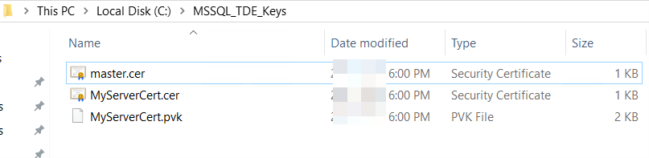
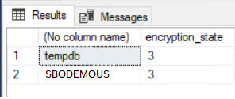

# Managing Data Encryption in Microsoft SQL Server (Enabling TDE)

Transparent Data Encryption (TDE) is a special case of encryption using a symmetric key. TDE encrypts an entire database using a symmetric key called the Database Encryption Key (DEK). The database encryption key is protected by other keys or certificates, which are protected either by the database master key or by an asymmetric key stored in an EKM module. For more information, see Transparent Data Encryption (TDE) (https://learn.microsoft.com/en-us/sql/relational-databases/security/encryption/transparent-data-encryption?view=sql-server-2017).

This section introduces the procedures of enabling TDE and removing TDE on the Microsoft SQL Server. It applies to MS SQL Server 2017.

## Enabling Transparent Data Encryption

**Context**

The following example shows the encryption of the `SBODEMOUS` database using a certificate named `MyServerCert` that's installed on the server.

**Procedure**

1. Open the SQL Server Management Studio.
2. Select the *SBODEMOUS* database.
3. Create the MASTER KEY and CERTIFICATE of the master system database by executing the following statement:

   ```sql
   USE master
   GO
   SELECT name, is_master_key_encrypted_by_server FROM sys.databases;
   GO
   ```

   This step is checking if the master database is encrypted. After executing the above statement, you can get the value `1` or `0`.

   `1` = Database has an encrypted master key,

   `0` = Database doesn't have an encrypted master key

4. Create a MASTER KEY and a CERTIFICATE by executing the following statement:

   ```sql
   CREATE MASTER KEY ENCRYPTION BY PASSWORD = '<UseStrongPasswordHere>';
   GO
   CREATE CERTIFICATE MyServerCert WITH SUBJECT = 'Master Protect DEK
   Certificate';
   GO
   ```

5. Create the DEK (Database Encryption Key) protected by `MyServerCert` (symmetric key) by executing the following statement:

   ```sql
   USE [SBODEMOUS]
   GO
   CREATE DATABASE ENCRYPTION KEY
   WITH ALGORITHM = AES_256
   ENCRYPTION BY SERVER CERTIFICATE MyServerCert;
   GO
   ```

   After executing the above statement, a warning message pops up. You should immediately back up the certificate and the private key associated with the certificate.

   > **Note**
   >
   > As of SQL Server 2016 (13.x), all algorithms other than AES_128, AES_192, and AES_256 are deprecated. To use older algorithms (not recommended), you must set the database to compatibility level 120 or lower.

6. Back up the MASTER KEY and CERTIFICATE of the master system database by executing the following statement:

   ```sql
   USE master
   GO
   OPEN MASTER KEY DECRYPTION BY PASSWORD = '<UseStrongPasswordHere>';
   BACKUP CERTIFICATE <certname> TO FILE ='path_to_cert_file'
         WITH PRIVATE KEY
         (
           FILE ='path_to_private_key_file',
           ENCRYPTION BY PASSWORD ='encryption_password'
         );
   BACKUP MASTER KEY TO FILE = 'path_to_master_key_file'
   ENCRYPTION BY PASSWORD = 'encryption_password';
   CLOSE MASTER KEY
   GO
   ```

   Check the argument description in the following table:

<!-- table: t234-01 -->
<!-- table: t234-02 -->
<!-- table: t234-03 -->
   - `certname`
     - **Description**: The name of the certificate that requires backing up.
   - `path_to_cert_file`, `path_to_private_key_file`, `path_to_master_key_file`
     - **Description**: Specifies the complete path, including the file name of the file in which the certificate is to be saved. This path can be a local path or a UNC path to a network location. If only a file name is specified, the file will be saved in the instance's default user data folder (which may or may not be the SQL Server DATA folder). For SQL Server Express LocalDB, the instance's default user data folder is the path specified by the %USERPROFILE% environment variable for the account that created the instance.
   - `encryption_password`
     - **Description**: The password that is used to encrypt the private key before writing the key to the backup file. The password is subject to complexity checks.

   The following screenshot shows an example of the path to files when the path is set to `MSSQL_TDE_Keys`:

   Figure: Example of the path to the backup files in the `MSSQL_TDE_Keys` folder.

   

   The `C:\MSSQL_TDE_Keys` folder contains three files: `master.cer` and `MyServerCert.cer` (security certificates) and `MyServerCert.pvk` (PVK file).

7. Enable TDE encryption for database TEST-TDE by executing the following statement:

   ```sql
   USE [SBODEMOUS]
   GO
   ALTER DATABASE [SBODEMOUS]SET ENCRYPTION ON
   GO
   ```

8. Check if the TEST-TDE database is encrypted by executing the following statement:

   ```sql
   SELECT DB_NAME(database_id),encryption_state FROM
   sys.dm_database_encryption_keys;
   GO
   ```

   > **Note**
   >
   > TDE is not available for system databases. It cannot be used to encrypt master, however model, or `msdb`.
   >
   > `tempdb` is automatically encrypted when a user database enabled TDE but cannot be encrypted directly.

**Results**

After executing all above statements, you can see the following query results:

Figure: Query results showing the encryption state of `tempdb` and `SBODEMOUS`.



Two result rows with columns (No column name) and `encryption_state`: `tempdb` with 3 and `SBODEMOUS` with 3.

Check the result description in the following table:

<!-- table: t235-01 -->
- *encryption_state*
  - **Messages**: Indicates whether the database is encrypted or not.
    - 0 = No database encryption key present, no encryption
    - 1 = Unencrypted
    - 2 = Encryption in progress
    - 3 = Encrypted
    - 4 = Key change in progress
    - 5 = Decryption in progress
    - 6 = Protection change in progress (The certificate or asymmetric key that is encrypting the database encryption key is being changed.)

For more information about column name descriptions, see sys.dm_database_encryption_keys (Transact- SQL) (https://learn.microsoft.com/en-us/sql/relational-databases/system-dynamic-management-views/sys-dm-database-encryption-keys-transact-sql?view=sql-server-ver16).

> **Recommendation**
>
> We strongly recommend that you encrypt the `B1if` database when working with the integration framework, because the `B1if` audit logs save users' personal information (first name, last name, email address and login IP address).
>
> However, we don't recommend that you save personal data into scenarios. If you have to enter the personal data in the integration framework when creating users or building scenarios, we suggest that you encrypt the `B1if` database or the following tables to avoid leaking data:
>
> ```text
> BZSTDOC
>
> MSGLOG
>
> XCLTRLOG
>
> XCLTRPOS
>
> DBQITEMS
> ```
