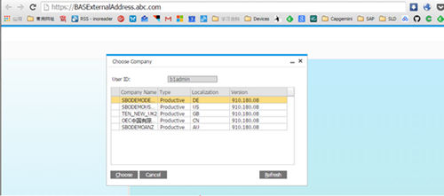
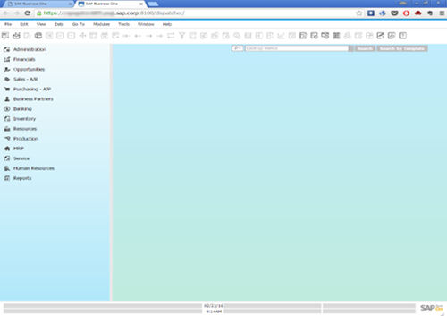

# Accessing SAP Business One in a Web Browser

**Prerequisites**

- You have ensured that you can log in to the SAP Business One client installed on the Browser Access server.
- You are using one of the following Web browsers:
  - Mozilla Firefox
  - Google Chrome
  - Microsoft Edge Ensure that you have enabled *Automatically Detect Intranet Network*.
  - Apple Safari (Mac and iPad) Ensure that you have enabled Adobe Flash Player. This is a prerequisite for Crystal dashboards.

**Context**

By default, no load balancing mechanism is applied. You can create a Web access portal and redirect requests to different Browser Access servers using a load balancing mechanism of your own choice, for example, round robin.

The following procedure illustrates how to access SAP Business One directly in a Web browser.

**Procedure**

1. In a Web browser, navigate to the external URL of the Browser Access service, for example: `https:// BASExternalAddress.abc.com:Port/dispatcher`.

   If you are uncertain about it, you can check the external address mapping in the SLD.

   The Browser Access page is opened.

   Figure: The Browser Access page.

   

2. Choose the company and log in.

   Now you can work with SAP Business One in your Web browser.

   Figure: SAP Business One running in a Web browser.

   
