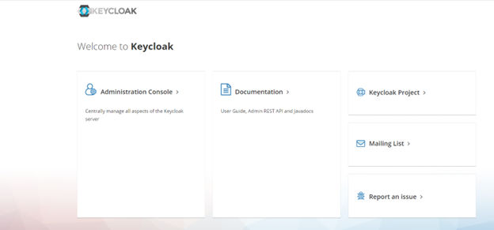

# Preparing External Addresses: NAT/PAT

If you intend to handle client requests using NAT/PAT, we recommend that you use the same domain name across internal and external networks. For example, both the internal and external domains are **abc.com**.

Prepare the external addresses as follows:

- Prepare one external address (hostname or IP address) for each of these components:
  - System Landscape Directory (SLD)
  - Authentication Server
  - Browser Access Service
  - Integration Framework (if you use the SAP Business One mobile solution)
  - Mobile Service
  - Web Client
  - Microsoft 365 Integration
- The combination of external address and port must be different for these components. In other words, if two components have the same external address, the ports they listen on must be different; and vice versa.
- The internal address and external address of each component must match the common name of the certificate purchased for both the internal and external domains.

> **Example**
>
> The internal URLs of the components are as follows:
>
> - System Landscape Directory: `https://SLDInternalAddress.abc.com:Port`
> - Authentication Server: `https://B1ASInternalAddress.abc.com:Port`
> - Browser Access Service: `https://BASInternalAddress.abc.com:Port/dispatcher`
> - Integration Framework: `https://B1iInternalAddress.abc.com:Port/B1iXcellerator`
> - Mobile Service: `https://MobileServiceInternalAddress.abc.com:Port/mobileservice`
> - Web Client: `https://WebClientsInternalAddress.abc.com:Port`
> - Microsoft 365 Integration: `https://Microsoft365IntegrationInternalAddress.abc.com:Port/ms365i`
>
> The external URLs are as follows:
>
> - System Landscape Directory: `https://SLDExternalAddress.abc.com:Port`
> - Authentication Server: `https://B1ASExternalAddress.abc.com:Port`
> - Browser Access Service: `https://BASExternalAddress.abc.com:Port/dispatcher`
> - Integration Framework: `https://B1iExternalAddress.abc.com:Port/B1iXcellerator`
> - Mobile Service: `https://MobileServiceExternalAddress.abc.com:Port/mobileservice`
> - Web Client: `https://WebClientsExternalAddress.abc.com:Port`
> - Microsoft 365 Integration: `https://Microsoft365IntegrationExternalAddress.abc.com:Port/ms365i`

## Connection Test

Run a connection test for the SLD by visiting the address `https://SLDExternalAddress.abc.com:Port/sld/sld0100.svc`. If the configuration is successful, you will see the following page:

Figure: The SLD service document page shown after a successful connection test.

A browser page displaying the XML service document of the SLD service (`xml:base` `https://10.58.114.74:40000/sld/sld0100.svc/`), listing collections such as ApplicationIdentifiers, ArchivedComponentDetectionLog, AssignmentProperties, AffinityGroups, BackupServices, B1CentralLogRepositories and SBOClients.

Now you can access the Authentication Service with a virtual web address: `https://B1ASExternalAddress.abc.com:Port/auth`.

Figure: The Authentication Service page reached through the virtual web address.

The Keycloak welcome page with the tiles Administration Console, Documentation, Keycloak Project, Mailing List and Report an issue.

> **Note**
>
> **Please make sure that the external address of the SLD is accessible from the internal network. If not, please configure a DNS entry resolving to Reverse Proxy server address.**

After finishing the connection test, you can configure the external address mapping. For more information, see [Mapping External Addresses to Internal Addresses](../../system-landscape-directory/external-address-mapping.md) [page 93].
