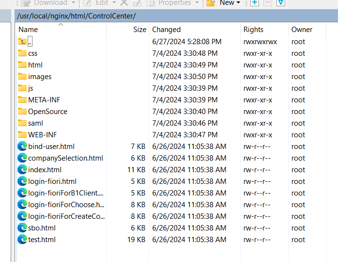
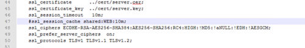
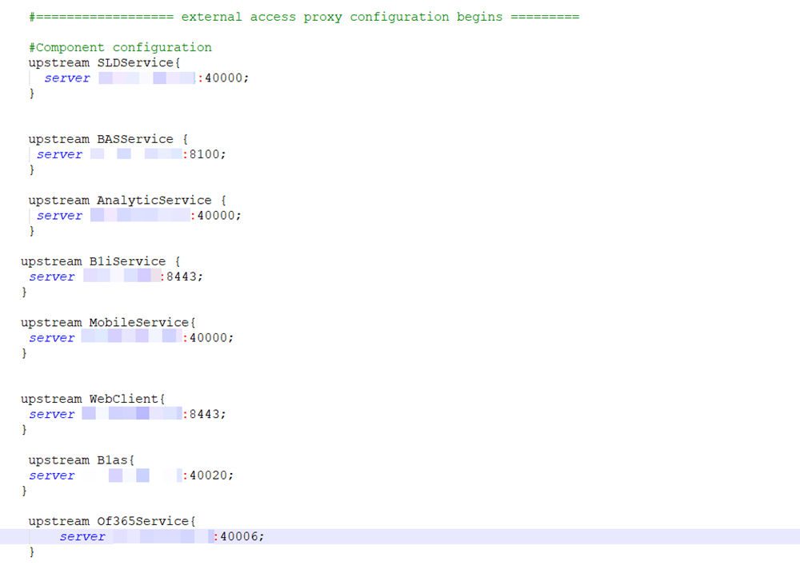
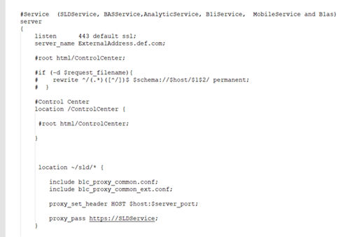
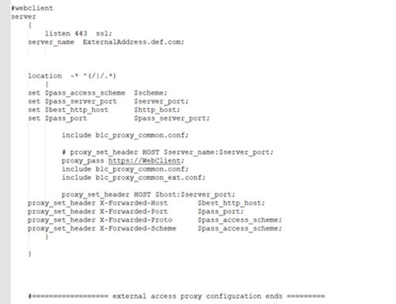
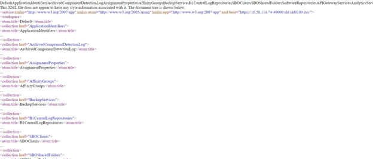

# Preparing External Addresses: Reverse Proxy Mode

- [Preparing External Addresses](#preparing-external-addresses)
- [Reverse Proxy Mode](#reverse-proxy-mode)
- [Configure Nginx Reverse Proxy](#configure-nginx-reverse-proxy)
- [Connection Test](#connection-test)
- [Set Up Dos Protection (Optional)](#set-up-dos-protection-optional)

## Preparing External Addresses

To expose your SAP Business One services to the Internet (external networks), you must prepare external addresses for relevant components.

> **Note**
>
> The Service Layer is for internal component calls only and you do not need to expose it to the Internet.

Please pay attention to the following points:

- The external address and the internal address of each component must be different; otherwise, the external networks cannot be distinguished from the internal network, making browser access impossible.
- Only one set of external addresses is supported. Communication via the DNS alias of an external address will lead to error.

## Reverse Proxy Mode

If you intend to handle client requests using a reverse proxy, we recommend that you use different domain names for internal and external domains. For example, the internal domain is **abc.corp** and the external domain is **def.com**.

Prepare the external addresses as follows:

- Prepare one external address for each of these components:
  - System Landscape Directory
  - Authentication Server
  - Browser Access Service
  - Integration Framework (if you use the SAP Business One mobile solution)
  - Mobile Service
  - Web Client
  - Microsoft 365 Integration
- The internal address of each component must match the common name of the certificate for the internal domain; the external address of each component must match the common name of the purchased certificate for the external domain.

> **Example**
>
> The internal URLs of the components are as follows:
>
> - System Landscape Directory: `https://SLDInternalAddress.abc.corp:Port`
> - Authentication Server: `https://B1ASInternalAddress.abc.corp:Port`
> - Browser Access Service: `https://BASInternalAddress.abc.corp:Port/dispatcher`
> - Integration Framework: `https://B1iInternalAddress.abc.corp:Port/B1iXcellerator`
> - Mobile Service: `https://MobileServiceInternalAddress.abc.corp:Port/mobileservice`
> - Web Client: `https://WebClientsInternalAddress.abc.corp:Port`
> - Microsoft 365 Integration: `https://Microsoft365IntegrationInternalAddress.abc.corp:Port/ms365i`
>
> The external URLs are as follows:
>
> - System Landscape Directory: `https://SLDExternalAddress.def.com:Port`
> - Authentication Server: `https://B1ASExternalAddress.def.com:Port`
> - Browser Access Service: `https://BASExternalAddress.def.com:Port/dispatcher`
> - Integration Framework: `https://B1iExternalAddress.def.com:Port/B1iXcellerator`
> - Mobile Service: `https://MobileServiceExternalAddress.def.com:Port/mobileservice`
> - Web Client: `https://WebClientsExternalAddress.def.com:Port`
> - Microsoft 365 Integration: `https://Microsoft365IntegrationExternalAddress.def.com:Port/ms365i`

## Configure Nginx Reverse Proxy

You can configure a nginx reverse proxy by performing the following steps:

**Prerequisites**

- You have predefined an external domain name and two ports for the SLD (System Landscape Directory) and other components. For example, `ExternalAddress.def.com`.
- You have obtained the `nginx_conf OP.zip` file (download it from here (https://help.sap.com/doc/549679a5e50e4ec09a9c50d048e31025/10.0/en-US)).

**Procedure**

1. From http://nginx.org/, download the nginx binary file according to your target operating system, and extract the binary file to a local folder. The recommended nginx version is 1.26.0 or higher.
2. Install nginx on a Windows server or a Linux server. Note that only version 9.2 PL03 and above support nginx installed on Linux servers. In addition, you must ensure that OpenSSL is enabled.
3. Copy the `ControlCenter` folder (located at `${SLDInstallationFolder}\webapps\ControlCenter`, for example, `C:\Program Files\SAP\SAP Business One ServerTools\System Landscape Directory\webapps\ControlCenter`) from the SLD server to the nginx server: `${nginx}\html\`.

   Figure: The ControlCenter folder copied to the nginx html folder.

   

   The remote folder `/usr/local/nginx/html/ControlCenter/` contains the subfolders css, html, images, js, META-INF, OpenSource, saml and WEB-INF, and the files bind-user.html, companySelection.html, index.html, login-fiori.html, login-fioriForB1Client.html, login-fioriForChoose.html, login-fioriForCreateCo...html, sbo.html and test.html.

4. Prepare certificates:
   1. Generate the `server.cer` and `server.key` files from your PKCS12 (.pfx) file using the OpenSSL library.
   2. Copy both files to the `${nginx}/cert` folder. If the `cert` folder does not already exist, create it manually.
5. Copy the `nginx_conf OP.zip` file to the `${nginx}/conf` folder and extract the content. Override any existing content, if necessary. If you use Windows servers for nginx, please comment out `ssl_session_cache shared:WEB:10m;` in the `nginx.conf` file.

   Figure: The extracted nginx configuration files in the conf folder.

   

   Configuration lines: `ssl_certificate ../cert/server.cer;`, `ssl_certificate_key ../cert/server.key;`, `ssl_session_timeout 10m;`, `ssl_session_cache shared:WEB:10m;` (commented out), `ssl_ciphers`, `ssl_prefer_server_ciphers on;` and `ssl_protocols TLSv1 TLSv1.1 TLSv1.2;`.

6. Configure the service addresses:
   1. Open the `b1c_extAddress.conf` file for editing.
   2. To specify the internal address and port of each component, modify the *Component Configuration* section.

      Figure: The Component Configuration section of b1c_extAddress.conf.

      

      The block starts with `external access proxy configuration begins` and defines one `upstream` per component, each with a `server` address (masked) and port: SLDService 40000, BASService 8100, AnalyticService 40000, B1iService 8443, MobileService 40000, WebClient 8443, B1as 40020, Of365Service 40006.

   3. To configure an external domain name for the components, modify the *Server and Port* information in the `b1c_extAddress.conf` file. Note that you must ensure the domain name is bound to the public IP address of this nginx server.

      Figure: The Server and Port section of b1c_extAddress.conf.

      

      A `server` block for SLDService, BASService, AnalyticService, B1iService, MobileService and B1as: `listen 443 default ssl;`, `server_name ExternalAddress.def.com;`, a `/ControlCenter` location, and a `location ~/sld/*` that includes `b1c_proxy_common.conf` and `b1c_proxy_common_ext.conf`, sets `proxy_set_header HOST $host:$server_port;` and uses `proxy_pass https://SLDService;`.

   4. For the Web client, use the same server name in step 3, and give a different port to be listened.

      Figure: The Web client server configuration in b1c_extAddress.conf.

      

      A `#webclient` `server` block: `listen 443 ssl;`, `server_name ExternalAddress.def.com;`, a `location ~* ^(/|/.*)` that sets `$pass_access_scheme`, `$pass_server_port`, `$best_http_host` and `$pass_port`, includes the common proxy files, uses `proxy_pass https://WebClient;`, and sets the X-Forwarded-Host, -Port, -Proto and -Scheme headers. The block ends with `external access proxy configuration ends`.

7. Go to `${nginx}/sbin` and start the nginx server.

**Results**

> **Example**
>
> The external addresses of the SLD and the other components are as follows:
>
> - System Landscape Directory: `https://ExternalAddress.def.com:8443`
> - Authentication Server: `https://ExternalAddress.def.com:8443`
> - Browser Access Service: `https://ExternalAddress.def.com:8443/dispatcher`
> - Integration Framework: `https://ExternalAddress.def.com:8443/B1iService`
> - Mobile Service: `https://ExternalAddress.def.com:8443/mobileservice`
> - Web Client: `https://ExternalAddress.def.com:443`
> - Microsoft 365 Integration: `https://ExternalAddress.def.com:8443/ms365i`

## Connection Test

Run a connection test for the SLD by visiting the address `https://<nginx server domain name>:<listening port number of SLD>/sld/sld0100.svc`, for example, `https://ExternalAddress.def.com:8443/sld/sld0100.svc`. If the configuration is successful, you will see the following page:

Figure: The SLD service document page shown after a successful connection test.



A browser page displaying the XML service document of the SLD service (`xml:base` `https://10.58.114.74:40000/sld/sld0100.svc/`), listing collections such as ApplicationIdentifiers, ArchivedComponentDetectionLog, AssignmentProperties, AffinityGroups, BackupServices, B1CentralLogRepositories and SBOClients.

Now you can access the Authentication Service with a virtual web address: `https://<nginx server domain name>:<listening port number of SLD>/auth`. In this example, `https://ExternalAddress.def.com:8443/auth`.

Figure: The Authentication Service page reached through the virtual web address.


The Keycloak welcome page with the tiles Administration Console, Documentation, Keycloak Project, Mailing List and Report an issue.

> **Note**
>
> **Please make sure that the external address of the SLD is accessible from the internal network. If not, please configure a DNS entry resolving to Reverse Proxy server address.**

After finishing the connection test, you can configure the external address mapping. For more information, see [Mapping External Addresses to Internal Addresses](../../system-landscape-directory/external-address-mapping.md) [page 93].

## Set Up Dos Protection (Optional)

The `ngx_http_limit_conn_module` module is used to limit the number of connections per the defined key, in particular, the number of connections from a single IP address.

There could be several `limit_conn` directives. For example, the following configuration will limit the number of connections to the server per a client IP (`limit_conn perip <number>`) and, at the same time, the total number of connections to the virtual server (`limit_conn perserver <number>`):

```text
limit_conn_zone $binary_remote_addr zone=perip:10m;
limit_conn_zone $server_name zone=perserver:10m;
server {
        …
        limit_conn perip 10;
        limit_conn perserver 100;
       }
```

For more information, see Module ngx_http_limit_conn_module (http://nginx.org/en/docs/http/ngx_http_limit_conn_module.html).
