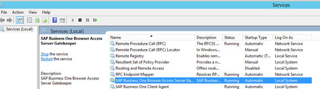

# Installing the Browser Access Service

## Context

To enable access to SAP Business One in a Web browser, you must install the browser access service on a server where the SAP Business One client is also installed. However, for security reason, we recommend that this client is not exposed to end users.

Compared with desktop access, browser access has certain limitations. For more information, see SAP Notes [2194215](https://me.sap.com/notes/2194215) and [2194233](https://me.sap.com/notes/2194233).

A setup wizard is used for installation as well as for upgrade. The following procedure describes how to install the browser access service.

## Procedure

1. Navigate to the root folder of the product package and run the `setup.exe` file.
2. In the welcome window, select your setup language and choose *Next*.
3. In the *Setup Type* window, select *Perform Setup* and choose *Next*.
4. In the *Setup Configuration* window, select *New Configuration* and choose *Next*.
5. In the *System Landscape Directory* window, do the following:
   a. Select *Connect to Remote System Landscape Directory*.

   > **Caution**
   >
   > Select this option even if you are installing the Browser Access service on the SLD server.

   b. Enter the FQDN of the SLD server.
   c. Choose *Next*.
6. In the *Certificate Verification Settings* window, enable or disable certificate verification.

   Figure: The Certificate Verification Settings window of the setup wizard.

   

   If the root certificate of the romote SLD has **not** been imported to the trusted store on the machine where you are running the installation, the certificate verification cannot be enabled. For more information, see SAP Note [3520401](https://me.sap.com/notes/3520401).

   You cannot choose to generate a self-signed certificate once you enable certificate verification.
7. In the *Landscape Administrator Logon* window, enter the password for the site super user `B1SiteUser`.

   This landscape administrator was created during the installation of the SLD.
8. In the *Database Server Connection* window, enter the database server information as follows:
   a. Specify the database server type.
   b. In the *Server Name* field, enter the fully qualified domain hostname (FQDN) of the database server.
   c. Choose *Next*.
9. In the *Component Selections* window, select the following components and choose *Next*:
   - Browser access service

   Note that the browser access service can be selected only if you have selected (or installed) SAP Business One client.
10. In the *Parameters for Browser Access Service* window, specify the following information for the browser access service:

    - Service URL: For the internal access URL of the service, specify:
      - The network address (hostname, IP address, or FQDN) of the machine
        If your server is domain-joined, we recommend that you specify the FQDN as the network address.
      - The port for the service (default: `8100`)
    - Security certificate: Enter a valid PKCS12 certificate store and password, or select the *Use Self-Signed Certificate* radio button.
      Communication between the browser access gatekeeper and SAP Business One clients or DI API is encrypted using the HTTPS protocol, so a certificate is required for authentication. You can obtain a certificate using the following methods:
      - Third-party certificate authority – You can purchase certificates from a third-party global Certificate Authority that Microsoft Windows trusts by default. If you use this method, select the *Specify PKCS12 Certificate Store and Password* radio button and enter the required information.
      - Certificate authority server – You can configure a Certificate Authority (CA) server in the SAP Business One landscape to issue certificates. You must configure all servers in the landscape to trust the CA’s root certificate. If you use this method, select the *Specify PKCS12 Certificate Store and Password* radio button and enter the required information.
      - [Not recommended] Generate a self-signed certificate – You can let the installer generate a self-signed certificate; however, your browser will display a certificate exception when you access SAP Business One in a Web browser, as the browser does not trust this certificate. To use this method, select the *Use Self-Signed Certificate* radio button.

    > **Note**
    >
    > If you enabled certificate verification in the previous step, you cannot choose to generate a self-signed certificate in this window.
11. In the *Review Settings* window, review your settings and proceed as follows:
    - To continue, choose *Next*.
    - To change the settings, choose *Back*.
12. In the *Setup Summary* window, choose *Next*.
13. In the *Setup Status* window, wait for the system to perform the required actions.
14. In the *Complete* window, choose *Finish*.

## Next Steps

The Browser Access service is registered as a Windows service SAP Business One Browser Access Server Gatekeeper. After installation, check if this Windows service runs under the `Local System` account.

Figure: The SAP Business One Browser Access Server Gatekeeper in the Windows Services list.

