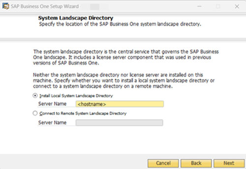
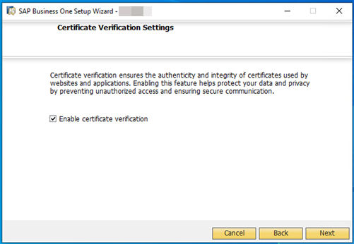
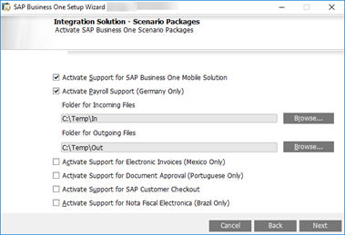

# Installing Server Components

- [Installing SAP Business One](#installing-sap-business-one)
- [Server Components to Install](#server-components-to-install)
- [Prerequisites](#prerequisites)
- [Procedure](#procedure)
- [Results](#results)

## Installing SAP Business One

The overall installation procedure of SAP Business One is as follows:

1. On a Windows server, [install server components](server-components-installation.md).
2. On each workstation, [install client components](../installing-client-components/installing-client-components.md).

> **Note**
>
> All SAP Business One components must be installed in the same LAN (local area network). For users outside the LAN of the server (for example, those using VPN connection), we recommend that you use a remote desktop to access the SAP Business One client instead of installing the SAP Business One client directly.

> **Recommendation**
>
> If your server is domain-joined, we recommend that you specify the FQDN as the network address of the database server, hostname or SLD address.
>
> FQDN stands for fully qualified domain name. The FQDN represents the absolute address of the internet presence. "Fully qualified” refers to the unique identification that guarantees that all the domain levels are specified. The FQDN contains the host name and domain, including the top-level domain, and can be uniquely assigned to an IP address. For example, `server.domain.com`.

For demonstration or testing purposes, you can install all components on the same Windows computer. You can also install the SAP Business One client on a terminal server or in a Citrix environment.

## Server Components to Install

You need to install the following components on the server:

- Server tools, including the following:
  - SLD, license manager, extension manager
  - Data interface server
  - Job service
  - Microsoft 365 Integration
  - Workflow service
  - Mobile service The mobile service depends on the Service Layer and the existence of system database `SBO-COMMON`; valid `SBO-COMMON` registration in SLD is required. Alternatively, you can install them separately using the SAP Business One Components Wizard by navigating to the folder `…\Packages.x64\ComponentsWizard` and running the `install.exe` file.
- Repository It includes the shared folder `B1_SHR`, the system database `SBOCOMMON`, and online help files in all supported languages.
- Demo databases

> **Note**
>
> As of release 10.0 FP 2102, if you want to install demo databases (schemas) for SAP Business One, you need to download the demo database zip files from the SAP Help Portal at https://help.sap.com/doc/1660bf9ea40a46e1916736665d024dc6/10.0/en-US/B1_Demo_Databases_Overview.pdf, and then import them manually.
>
> You can also navigate to the demo database download page from the *Component Selections* window in the setup wizard during the server components installation or upgrading process.
>
> For more information about deploying demo databases, see [Deploying Demo Databases](../demo-databases-and-external-access/demo-databases.md).

> **Note**
>
> The system database `SBOCOMMON` and demo databases can be installed also from the System Landscape (SLD) control center. For more information, see [Performing Centralized Deployment](../centralized-deployment/registering-installation-cd.md).

- Microsoft Outlook integration server
- Remote support platform
- Service Layer, Web Client, Electronic Document Service, Electronic File Mapping Transformation Service, and API Gateway Service You can install the Service Layer, Web Client, Webhook Messenger, Electronic Document Service, Electronic File Mapping Transformation Service, and API Gateway Service using SAP Business One Setup Wizard. Alternatively, you can install them separately using SAP Business One Components Wizard by navigating to the folder `…\Packages.x64\ComponentsWizard` and running the `install.exe` file. For more information, see [Installing the Service Layer](service-layer.md), [Installing Web Client](web-client.md), [Installing Webhook Messenger](webhook-messenger.md), [Installing Electronic Document Service](electronic-document-service.md), and [Installing Electronic File Mapping Transformation Service](electronic-file-mapping-transformation-service.md).
- Integration framework If you want to install the integration framework separately, navigate to the `…\Packages.x64\B1 Integration Component\Technology` folder and run the `setup.exe` file.
- Add-ons By installing the SAP add-ons as part of the server installation process, you register them to all companies on the server. If you do not install them now, you will have to register the add-ons manually later in the SAP Business One client.

If you want to enable access to the SAP Business One client in a Web browser, follow the instructions in [Installing the Browser Access Service](browser-access-service.md).

> **Caution**
>
> The SAP Business One installation creates a new SQL user and password. Do not modify or delete this user ID or password. They are essential for the correct operation of the SAP Business One application.

## Prerequisites

- The installation computer complies with all hardware and software requirements. For information on hardware and software requirements, search for the related information on SAP Help Portal (https://help.sap.com/viewer/p/SAP_BUSINESS_ONE_PRODUCT_LINE).
- You have administrator rights on the machine on which you are performing the installation.

> **Note**
>
> For more information about possible installer issues related to the user account control (UAC) in Microsoft Windows operating systems, see SAP Note 1492196 (https://me.sap.com/notes/1492196).

- The host name of the Microsoft SQL Server does not contain any special characters, such as: & (ampersand), < (left angle bracket), > (right angle bracket), ” (double quotation mark), ' (single quotation mark), or _ (underscore).
- Your Microsoft SQL Server has been installed with the following settings:

<!-- table: t034-01 -->
- **Setting**: TCP/IP
  - **Description**: Enabled
- **Setting**: Service Account
  - **Description**: Use the built-in system account – Local System
- **Setting**: Authentication Mode
  - **Description**: Mixed mode (Windows authentication and SQL Server authentication)
- **Setting**: Collation Settings
  - **Description**:

    *SQL collations – Dictionary order case-insensitive, for use with 1252 Character set, Accent - Sensitive (SQL_Latin1_General_CP1_CI_AS).*

    > **Note**
    >
    > In some versions of Microsoft SQL Server, this collation may be available only for backward compatibility.

- You have installed the Microsoft SQL Server database client on the machine on which you are performing the installation.
- [For the Integration Framework] You have not yet configured a default Tomcat installation on your machine; otherwise, you cannot proceed with the installation. During the installation process, the setup checks for the following registry entry for 64-bit system, and if found, the setup terminates: `HKEY_LOCAL_MACHINE\SOFTWARE\Wow6432Node\Apache Software Foundation\Procrun2.0\Tomcat<version>`
- If you want to install SAP Business One job service in version SAP Business One 10.0 PL02 or higher, make sure that you have installed the Service Layer.
- If you want to specify the FQDN as the network address of the database server, hostname or SLD address during the installation, make sure that you have specified the fully qualified domain hostname (FQDN) as the *Full computer name* of the Windows servers. You may need to check or change the *Full computer name* for the Windows server in the *System Properties* window (on your Windows server, search *Advanced system settings*).

## Procedure

A setup wizard in the upgrade package is used for installing SAP Business One in a clean environment (where no SAP Business One component exists) as well as for upgrading an existing environment. The following procedure describes how to install **all** server components (except for the remote support platform, the browser access service, and the Service Layer) in a clean environment where no SAP Business One components exist.

> **Note**
>
> - The installation of remote support platform is performed by a separate installation wizard. For more information, see *Administrator’s Guide to the Remote Support Platform for SAP Business One*. You can find the guide at Remote Support Platform for SAP Business One (https://help.sap.com/docs/REMOTE_SUPPORT_PLATFORM_FOR_SAP_BUSINESS_ONE?ai=true).
> - The installation of the Service Layer is performed by a separate installation wizard. For more information, see [Installing the Service Layer](service-layer.md).

1. Navigate to the root folder of the product package and run the `setup.exe` file.
2. In the welcome window, select your setup language and choose *Next*.
3. In the *Setup Type* window, select *Perform Setup* and choose *Next*.
4. In the *Setup Configuration* window, select *New Configuration* and choose *Next*.
5. In the *System Landscape Directory* window, select *Install Local System Landscape Directory*. . The field *Server Name* is prefilled with the fully qualified domain hostname (FQDN) of the computer where the installation is running. You may check if the FQDN of the computer is correct here and update it if necessary.

Figure: The System Landscape Directory window of the setup wizard.



Choose *Next*.

6. In the *Certificate Verification Settings* window, enable or disable certificate verification. The checkbox *Enable certificate verification* is checked by default. When you choose to enable certificate verification, make sure that you obtain a valid certificate and don't use a self-signed certificate. For more information about the necessary prerequisites, see SAP Note 3520401 (https://me.sap.com/notes/3520401).

Figure: The Certificate Verification Settings window of the setup wizard.



> **Note**
>
> If you intend to install the server components in silent mode, you need to first update the `Config.XML` file and then run the upgrade command:
>
> 1. Navigate to the configuration directory `C:\Users\<user>\AppData\Local\SAP\SAP Business One\SetupWizard\Config`
> 2. Open the configuration file `Config.XML` and add the relevant parameters to enable or disable the certificate verification:
>    - If you want to enable the certificate verification, add the following parameter:
>
>      ```xml
>      <CertificateVerification>
>      <Enabled>Yes</Enabled>
>      </CertificateVerification>
>      ```
>    - If you want to disable the certificate verification, add the following parameter:
>
>      ```xml
>      <CertificateVerification>
>      <Enabled>No</Enabled>
>      </CertificateVerification>
>      ```
> 3. Run the following command: `setup.exe "C:\Users\<user>\AppData\Local\SAP\SAP Business One\SetupWizard\Config\config.xml" -upgrade`

7. In the *New System Landscape Directory* window, specify a password for the landscape super user `B1SiteUser`, confirm the password, and then choose *Next*. For security reasons, you are required to specify a strong landscape administrator password according to the password policies in the window. As of release/version 10.0 FP 2305, when you newly install SAP Business One, your password must comply with the following password policies:
   - Minimum length in characters: 8
   - Minimum number of digits: 1
   - Minimum number of uppercase characters: 1
   - Minimum number of lowercase characters: 1
   - Minimum number of non-alphanumeric characters: 1

   For details on which special characters are not allowed for a landscape administrator password, see SAP Note 2330114 (https://me.sap.com/notes/2330114). For more information about landscape administrators, see [SAP Business One Landscape Administrators](../security-landscape-users-authorization/user-types.md#sap-business-one-landscape-administrators).
8. In the *Database Server Registration* window, enter the database server information as follows:
   1. Specify the Microsoft SQL Server version.
   2. In the *Server Name* field, enter the fully qualified domain hostname (FQDN) of the database server. To specify a local machine, enter `localhost`. Do not enter `local`. If your database server does not use the default TCP port `1433`, you must add the alternative port (for example, `9033`) to the server name as follows: `SERVER_NAME,9033`.
   3. To use database authentication to validate access to the Microsoft SQL server instance, specify the database username and password.

   > **Note**
   >
   > If you later change the password of the database user used to install the System Landscape Directory (SLD), the SLD will stop working.

   4. Choose *Next*.

   > **Note**
   >
   > During the SAP Business One installation, only the secure connection between the Microsoft SQL Server database and SAP Business One and client components using the Transport Layer Security (TLS) protocol is supported.
9. In the *Component Selections* window, select the appropriate components and choose *Next*.

> **Note**
>
> As of release 10.0 FP 2102, if you want to install demo databases (schemas) for SAP Business One, you need to download the demo database zip files from the SAP Help Portal at https://help.sap.com/doc/1660bf9ea40a46e1916736665d024dc6/10.0/en-US/B1_Demo_Databases_Overview.pdf, and then import them manually.

You can also navigate to the demo database downloading page from the *Component Selections* window in the setup wizard during the server components installation or upgrade process. For more information, see [Deploying Demo Databases](../demo-databases-and-external-access/demo-databases.md).

10. In the *Port for Server Tools* window, specify a port number that is used by the server tools and choose *Next*. The default port number is `40000`.
11. In the *Port for License Service* window, specify a port number that is used by the license service and choose *Next*. The default port number is `40002`.
12. If you choose to install Job Service, the *Port for Job Service* window appears. In this window, specify a port number that is used by the job service and choose *Next*. The default port number is `40004`.
13. If you choose to install Service Layer or Mobile Service, the *Port for Service Layer Controller and Mobile Service* window appears. In this window, specify a port number that is used by the service layer controller and mobile service and choose *Next*. The default port number is `40005`.
14. If you choose to install Microsoft 365 Integration, the *Port for Microsoft 365 Integration* window appears. In this window, specify a port number that is used by the Microsoft 365 integration and choose *Next*. The default port number is `40006`.
15. In the *System Landscape Directory Service Preferences* window, enter a valid PKCS12 certificate store and password, or select the *Use Self-Signed Certificate* radio button. Communication between the SLD and SAP Business One clients or DI API is encrypted using the HTTPS protocol, so a certificate is required for authentication. You can obtain a certificate using the following methods:

    - Third-party certificate authority – You can purchase certificates from a third-party global Certificate Authority that Microsoft Windows trusts by default. If you use this method, select the *Specify PKCS12 Certificate Store and Password* radio button and enter the required information
    - Certificate authority server – You can configure a Certificate Authority (CA) server in the SAP Business One landscape to issue certificates. You must configure all servers in the landscape to trust the CA’s root certificate. If you use this method, select the *Specify PKCS12 Certificate Store and Password* radio button and enter the required information.
    - [Not recommended] Generate a self-signed certificate – You can let the installer generate a self-signed certificate; however, your browser will display a certificate exception when you access the SLD server, as the browser does not trust this certificate. To use this method, select the *Use Self-Signed Certificate* radio button.

    > **Note**
    >
    > If you enabled certificate verification in the *Certificate Verification Settings* window, you cannot choose to generate a self-signed certificate in this window.
16. If you choose to install the API Gateway Service, the *API Gateway Service* window appears. In this window, specify the port numbers that are to be used by the API Gateway Service components and choose *Next*. The default port number for the Authentication Service is `60010` and the default port number for the Gateway Service is `60020`.

    > **Note**
    >
    > The port number must be within the `0-65535` range.
17. For the integration framework, perform the following steps:
    1. In the *Integration Solution - Change Administration Password* window, enter and confirm a new password for the integration server administrator account (`B1iadmin`).

       > **Note**
       >
       > For security reasons, we recommend that you provide the integration server administrator account (`B1iadmin`) to the system administrator only
    2. In the *Integration Solution - B1i Database Connection Settings* window, specify the following:
       - *Server Type*: Specify the Microsoft SQL Server version.
       - *Server Name*: Enter the fully qualified domain hostname (FQDN) of the database server. To specify a named instance, enter `<hostname\<instance name>` and leave the *Database Port* field empty.
       - *Port*: Specify the port for the database server.
       - *Database Name*: Specify a name for the integration framework database. The default database name is `IFSERV`.
       - *Database User ID*: Enter the username of a database administrator account (role: `PUBLIC`; system privilege: `CREATE SCHEMA`).
       - *Database Password*: Enter the password for the database administrator account.
    3. In the *Integration Solution - Additional Information* window, do the following:
       - Enter the connection credentials. If you did not select to use a trusted connection (Windows authentication) for connections to the database server instance, specify an SAP Business One user account (`B1i` by default) and a password. This user account will be used for DI calls. If you selected to use a trusted connection (Windows authentication) for connections to the database server instance, in addition to specifying an SAP Business One user account for DI calls and a password, also enter the username and password of a database server administrator account.
       - Select the version of SAP Business One DI API to use. We recommend using the 64-bit SAP Business One DI API. For more information, see SAP Note 2066060 (https://me.sap.com/notes/2066060). If a version of DI API is not installed or is not selected for installation, that version of DI API is not available for selection. If no DI API is selected or installed, you cannot proceed with the installation of the integration framework.
    4. In the *Integration Solution - Scenario Packages* window, select the corresponding checkboxes to activate required scenario packages.

       Figure: The Integration Solution - Scenario Packages window of the setup wizard.

       

       The window lists the checkboxes *Activate Support for SAP Business One Mobile Solution* and *Activate Payroll Support (Germany Only)* (both selected in the example). Payroll Support adds the fields *Folder for Incoming Files* (example `C:\Temp\In`) and *Folder for Outgoing Files* (example `C:\Temp\Out`), each with a *Browse* button. Unselected options: *Activate Support for Electronic Invoices (Mexico Only)*, *Activate Support for Document Approval (Portuguese Only)*, *Activate Support for SAP Customer Checkout* and *Activate Support for Nota Fiscal Electronica (Brazil Only)*.
18. In the *Review Settings* window, review the settings you have made and choose *Next*. This window provides an overview of the settings that you have configured for the setup process. To modify any of the settings, edit the values in the table.
19. In the *Setup Summary* window, review the component list and choose *Setup* to start the setup process.
20. In the *Setup in Process* window, wait for the setup to finish.
21. Depending on the results of the setup, one of the following windows is displayed:
    - *Setup Result: Successful* window: The wizard opens this window if the setup of all components was successful. To continue, choose *Next*.
    - *Setup Result: Errors* window: The wizard opens this window if the setup of one or more components failed. To continue, choose *Next* and then in the *Restoration* window, do either of the following:
      - Select the failed component and proceed to start the restoration process.
      - Choose *Next* to skip the restoration.

    > **Note**
    >
    > If the installation of remote support platform for SAP Business One fails, it does not affect the successful installation of SAP Business One.
22. In the *Congratulations* window, choose *Finish* to close the wizard

## Results

You can now proceed to install client components on all workstations.

An operating system user `B1_Tech_User` (repository access user) is created and used to move log files from client machines to a central log folder in the shared folder `B1_SHR`. You may change the user in the SLD by editing the server information. The user must be either a local user or a domain user that has write permissions to the central log folder (`\B1_SHR\Log`) and read permissions to the entire shared folder.

An internal technical user `b1scswworkingshare` is created during the SLD installation. It is used to enable the functionality of performing centralized deployment. The user has the permission to use the share folder `SCSW_WORKING_SHARE`.

The installation of the remote support platform does not impact SAP Business One business processes. There is no technical dependency between SAP Business One and the remote support platform.
