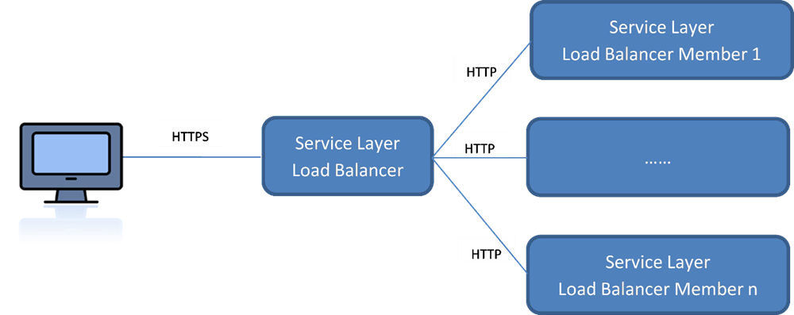
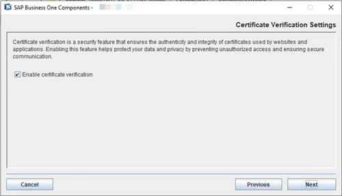
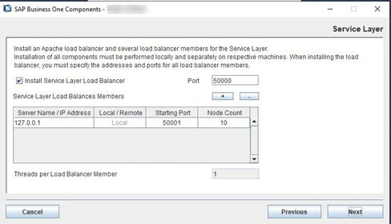

# Installing the Service Layer

## Prerequisites

You have installed Windows PowerShell 5 or the higher version on the machine on which you are performing the installation.

## Context

The Service Layer is an application server that provides Web access to SAP Business One services and objects. It uses the Apache HTTP Server (or simply Apache) as the load balancer, which works as a transit point for requests between the client and various load balancer members. The architecture of the Service Layer is illustrated below (Note that the communication between the load balancer and the load balancer members is transmitted via HTTP instead of HTTPS):

Figure: The architecture of the Service Layer: clients connect over HTTPS to the load balancer, which connects over HTTP to load balancer members 1 to n.

You may set up the Service Layer in one of the following ways:

- The load balancer and load balancer members are all installed on different physical machines. Note that at least one load balancer member must be installed on the same machine as the load balancer.
- [Recommended] The load balancer and all load balancer members are installed on the same machine.

Remote installation of the Service Layer is **not** supported. For example, if you intend to install the load balancer on server A and two load balancer members on server B and C, you must run the server components setup wizard on each server separately.

The following procedure describes how to install the Service Layer by using the Components Setup Wizard.

## Procedure

1. Navigate to the installation folder for the Service Layer (default path: `\Packages.x64\ComponentsWizard`).
2. Run the `install.exe` file.
3. In the *Setup Wizard* window, select *Installation and Upgrade* and choose *Next*.
4. In the *Select Features* window, select *Service Layer* and choose *Next*.
5. In the *Certificate Verification Settings* window, enable or disable certificate verification. The checkbox *Enable certificate verification* is checked by default.

   When you choose to enable certificate verification, make sure that you obtain a valid certificate and don't use a self-signed certificate. For more information about the necessary prerequisites, see SAP Note [3520401](https://me.sap.com/notes/3520401).

   Figure: The Certificate Verification Settings window of the components setup wizard.

   
6. In the *Network Address* window, select an IP address, or use the hostname, as the network address for the selected components and choose *Next*. The hostname is prefilled with the full qualified domain name (FQDN).
7. In the *Service Port* window, specify a port number that is to be used by the Service Layer for single single-on (SSO) and choose *Next*. The default number is `40000`.
8. In the *Specify Security Certificate* window, specify a security certificate and choose *Next*. You can also choose to use a self-signed certificate.

   Communication between the SLD and SAP Business One clients or DI API is encrypted using the HTTPS protocol, so a certificate is required for authentication. You can obtain a certificate using the following methods:

   - Third-party certificate authority – You can purchase certificates from a third-party global Certificate Authority that Microsoft Windows trusts by default. If you use this method, select the *Specify PKCS12 Certificate Store and Password* radio button and enter the required information
   - Certificate authority server – You can configure a Certificate Authority (CA) server in the SAP Business One landscape to issue certificates. You must configure all servers in the landscape to trust the CA’s root certificate. If you use this method, select the *Specify PKCS12 Certificate Store and Password* radio button and enter the required information.
   - [Not recommended] Generate a self-signed certificate – You can let the installer generate a self-signed certificate; however, your browser will display a certificate exception when you access the SLD server, as the browser does not trust this certificate. To use this method, select the *Use Self-Signed Certificate* radio button.

   > **Note**
   >
   > If you enabled certificate verification in the previous step, you cannot choose to generate a self-signed certificate in this window.
9. In the *Landscape Server* window, enter the landscape server address and the landscape administrator password, and choose *Next*.

   > **Note**
   >
   > The installation process can only be continued by entering the credentials of the `B1SiteUser` account. Other landscape administrators do not have the permissions to perform this operation.
10. If only one database instance is registered in the SLD, the Service Layer is automatically bound to the database instance; if multiple database instances are registered in the SLD, you need to choose one database instance from the dropdown list in the *Database Instances* window.
11. In the *Service Layer* window, specify the following information for the Service Layer and then choose *Next*:
    - *Install Service Layer Load Balancer* and *Port*: Select the checkbox to install the load balancer and specify the port for the load balancer.
      When installing the load balancer, you need to specify the following information:
      - The port for the load balancer. The default port for the load balancer is `50000`.
      - The fully qualified domain hostname (FQDN) of all load balancer members, as well as their ports.

      Note that the load balancer and load balancer members must use a different port for each if installed on the same machine.
    - *Service Layer Load Balancer Members*: Specify the server address and port for each load balancer member.
      If you have selected the *Install Service Layer Load Balancer* checkbox, you can specify load balancer members either on local (current) or remote (different) machines. If on the local machine, the installer will create a local load balancer member; if on a remote machine, the load balancer member will be added to the pool (cluster) of load balancer members, but you need to install the specific load balancer member on its own server.
      *Starting Port*: The port for the first balancer member. The default starting port is `50001`.
      *Node Count*: The total number of the load balance members. The default node count is `10`.

      > **Example**
      >
      > If you specify 5 load balancer members on a local machine and the starting port is `50001`, the corresponding ports for the other 4 load members are as follows:
      >
      > - `50002`
      > - `50003`
      > - `50004`
      > - `50005`
      >
      > The node count is 5.

      If you have not selected the checkbox, you cannot edit the server address, which is automatically set to `127.0.0.1` (`localhost`). All specified load balancer members will be created.

      > **Note**
      >
      > Ipv6 addresses are not allowed.
    - *Threads per Load Balancer Member*: The number of threads to be run for each load balancer member. The default value is `1` and you cannot change it.

    Figure: The Service Layer window of the components setup wizard, showing the load balancer port, the load balancer members table and the threads per member.

    

    In the example, the *Install Service Layer Load Balancer* checkbox is selected and *Port* is `50000`. The members table has the columns *Server Name / IP Address*, *Local / Remote*, *Starting Port* and *Node Count*, with one row: `127.0.0.1`, Local, `50001`, `10`. *Threads per Load Balancer Member* shows `1`. The *+* and *-* buttons add and remove members.
12. In the *Review Settings* window, review your settings and then choose *Install* to start the installation.
13. In the *Setup Progress* window, when the progress bar displays 100%, choose *Next* to finish the installation.
14. In the *Setup Process Completed* window, review the installation results, and then choose *Finish* to exit the wizard.

## Results

The Service Layer runs under the local system as all other SAP Business One services on Windows; user permissions for this user account should not be changed.

After installing the Service Layer, you can check the status of each balancer member in the balancer manager. To do so, in a Web browser, navigate to `https://<Load Balancer Address>:<Load Balancer Port>/balancer-manager`.

When installation is complete, the default Web browser on your server opens with links to various documentation files (for example, the user guide and the API reference). The documentation files are stored in the `<Installation Folder>/ServiceLayer/doc/` folder. In addition, you can access the API help document for the Service Layer in a Web browser from anywhere via this URL: `https://<Load Balancer Address>:<Load Balancer Port>`. Note that only the following Web browsers are supported:

- Microsoft Internet Explorer 7 and higher
- Google Chrome
- Mozilla Firefox
- Apple Safari

After installing the Service Layer, you can see the log file under `%ProgramData%\SAP\SAP Business One\Log\SAP Business One\%USERNAME%\B1WinInstaller_xxxxxxxxxxxx.log`.

> **Note**
>
> To upgrade the Service Layer to a higher patch level, run the components setup wizard for the required patch level. For more information, see [Upgrading SAP Business One Databases and Components](../upgrade-process/upgrading-databases-and-components.md) [page 72].
