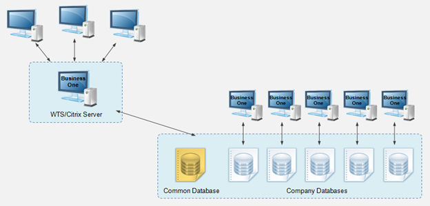
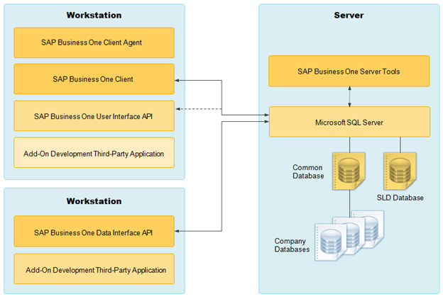

# Application Architecture

## Introduction

The SAP Business One Administrator's Guide provides a central point of guidance for the technical implementation of SAP Business One. Use this guide for reference and instructions before and during the implementation project.

This Administrator's Guide applies to the latest release of SAP Business One. For more information about the previous versions of the Administrator's Guide delivered in SAP Business One 10.0, see the Previous Versions of Administrator’s Guide for SAP Business One 10.0 (https://help.sap.com/viewer/142a717d160a481eab2882142cf5414a/10.0/en-US/b18a45a32eb1468b84e5a19c89958614.html).

For the latest information that may not appear in this guide, see the following SAP Notes:

- SAP Note 2826255 (https://launchpad.support.sap.com/#/notes/2826255) (Central Note for SAP Business One 10.0)
- SAP Note 2830129 (https://launchpad.support.sap.com/#/notes/2830129) (Release Update Note for SAP Business One 10.0)
- SAP Note 2830158 (https://launchpad.support.sap.com/#/notes/2830158) (Collective Note for SAP Business One 10.0 Upgrade issues)
- SAP Note 2830193 (https://launchpad.support.sap.com/#/notes/2830193) (Collective Note for SAP Business One 10.0 General issues)

## Application Architecture

SAP Business One is a client-server application consisting of a fat client, a database server, and various services. The database stores only data and does not use triggers. However, the database does use views, especially for reporting and upgrade purposes.

The following figure provides an overview of the server architecture of SAP Business One:

Figure: SAP Business One Server Architecture.

The diagram shows three client workstations connected to a WTS/Citrix server running SAP Business One. That server connects to a database group containing one common database and five company databases, each company database linked to its own SAP Business One client instance.

The following figure provides an overview of the client architecture of SAP Business One:

Figure: SAP Business One Client Architecture.

The diagram shows a server hosting the SAP Business One Server Tools and Microsoft SQL Server. The SQL Server holds the common database, the SLD database and the company databases. Two kinds of workstations connect to the server. One runs the SAP Business One Client Agent, the SAP Business One Client, the User Interface API and add-on or third-party applications. The other runs the Data Interface API and add-on or third-party applications.
