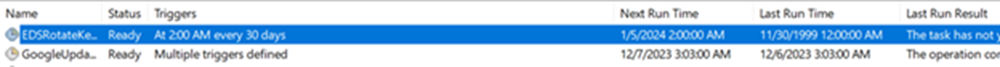

# Electronic Document Service: Encryption and Key Rotation

- [Encryption](#encryption)
- [Scheduled Periodic Key Rotation](#scheduled-periodic-key-rotation)
- [Manual Key Rotation](#manual-key-rotation)
- [Verification of Key Rotation Results](#verification-of-key-rotation-results)

The following subsections describe security details for the management of information in Electronic Document Service (EDS), the protection of sensitive data used in EDS, and relevant administration activities.

## Encryption

Sensitive data in EDS, which persist on storage medium like disks, are encrypted for scenarios like:

- documents that are communicated with the authorities
- certificates used for electronic communication
- specific electronic communication secrets
- sensitive EDS settings

Symmetric encryption is applied to protect sensitive data that are in local storage. Encryption keys, which are used during encryption, are generated automatically and are not accessible to users or administrators. Encryption keys **must be** changed periodically (through key rotation), to limit any damage or exposure of encrypted data if the key becomes compromised or computable. During a new installation, sensitive content is encrypted. During upgrades, sensitive content is re-encrypted automatically. If encryption tasks fail, installations fail. During all EDS installation scenarios, automatic key rotation tasks are scheduled to regularly re-encrypt sensitive content. **Periodic key rotation is mandatory**. Administrators can start key rotations manually, using tools that are described in [Manual Key Rotation](#manual-key-rotation) [page 254].

## Scheduled Periodic Key Rotation

Regular and periodic re-encryption of sensitive data in EDS is implemented through Task Scheduler. Operating system administrators can verify scheduled tasks by starting the Task Scheduler utility, then selecting the folder *Task Scheduler Library*, and searching for *EDSRotateKeyTask*:

Figure: The Task Scheduler Library listing showing the EDSRotateKeyTask scheduled task.



Scheduled tasks are executed every 30 days at 02:00 (2 am) server time.

## Manual Key Rotation

Operating system administrators can start the re-encryption of sensitive data manually. This is strongly recommended when there is a suspicion that EDS data were compromised by an attack or for any other reason. As the first action, EDS must be stopped before the key rotation can start. After the key rotation has finished, EDS can be started again. The following three commands need to be executed in the following specific sequence:

```text
net stop SAPB1EDFBackend

"C:\Program Files\SAP\SAP Business One EDS\bin\EDSTool\EDSTool.exe RotateKey"

net start SAPB1EDFBackend
```

After all commands and the execution have finished successfully, sensitive data are re-encrypted.

## Verification of Key Rotation Results

The results of sensitive data re-encryption in EDS can be verified by operating system administrators in EDS logs. The relevant logs are in files:

- for scheduled periodic key rotation: `C:\ProgramData\SAP\SAP Business One\Log\SAP Business One EDS\EDSDeploymentTool\Common.log.#`
- for manual key rotation: `C:\ProgramData\SAP\SAP Business One\Log\SAP Business One EDS\EDSTool\Common.log.#`

where “`#`” is a sequence number of the recent log files in the folder. Inside the files, the start of the key rotation operation is denoted by the text “`Executing encryption key rotation`”, for example:

```json
{date-and-time} INFO [ 1] [EDFBackend.EDSToolBase.DataEncryption.RotateKeyAction]:
Executing encryption key rotation
```

Various technical details follow that are specific to the re-encrypted data (including PKI, database, and settings). A successful and complete key rotation operation finishes with the text “`Encryption key rotation successfully executed`”, for example:

```json
{date-and-time} INFO [.NET TP Worker]
[EDFBackend.EDSToolBase.DataEncryption.RotateKeyAction]: Encryption key rotation
successfully executed
```

If a key rotation fails, then a corresponding error is listed in the log files.
