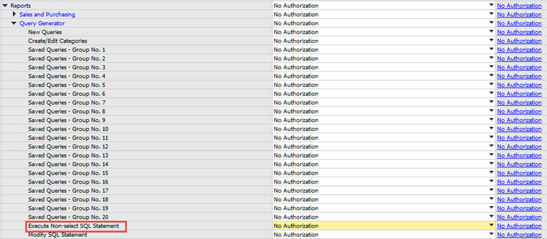

# Queries: Granting Read-Only Authorization for Query Results

The query wizard and query generator enable you to define queries on the SAP Business One database. These tools are designated for `SELECT` sentences only and cannot be used for any kind of update operation. To protect your data, we recommend that you make sure users have the appropriate permissions. However, the data results returned are not filtered according to the user’s authorization.

## Granting Read-Only Authorization for Query Results

To enable an SAP Business One user to view the results of both system and user-defined queries, you can directly grant the user full authorization to the `Execute Non-select SQL Statement` permission item in the *General Authorizations* window in the SAP Business One client application (*Main Menu* > *System Initialization* > *Authorizations* > *General Authorizations*).

Figure: The General Authorizations window with the Execute Non-select SQL Statement item under Reports, Query Generator highlighted.

However, we recommend that you grant read-only authorization to all non-superusers in one of the following ways:

- [**Recommended**] Do the following:
  1. Configure SAP Business One to access your company using database users without administrator privileges.
  2. Grant No authorization to all non-superusers in the *General Authorizations* window.

  This way, users with No authorization to the `Execute Non-select SQL Statement` authorization item can access the database only through a read-only database user.

- If you configure SAP Business One to access your company using a database administrator user, do the following:
  1. Apply No authorization to all users to the `Execute Non-select SQL Statement` item.
  2. Create a read-only database user and define the user password.
  3. Assign the database user to the company in the *Read-Only DB User* window in the SAP Business One client application. For more information, see the SAP Business One online help.
