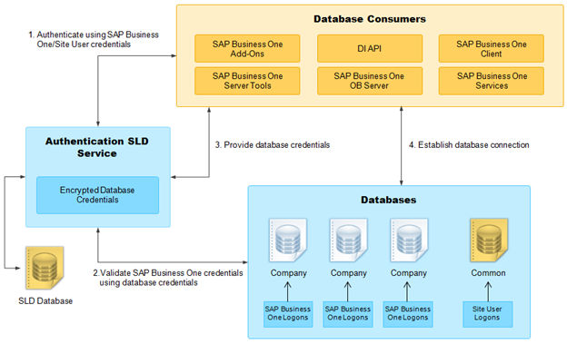

# Technical Landscape

Your security requirements are not limited to SAP Business One but apply to your entire system landscape. Therefore, we recommend establishing a security policy that addresses the security issues of the entire company. This section offers several recommendations to help you meet the security demands of SAP Business One.

After establishing a security policy, we recommend that you dedicate sufficient time and resources to implementing and maintaining the required level of security.

## Technical Landscape

In SAP Business One, the System Landscape Directory serves as the security server, which saves database credentials in the SLD database.

Database credentials are obtained by supplying SAP Business One logon credentials for authentication against the SLD service. Upon successful authentication, connections to common and company databases are established using database credentials from the SLD service.

The following figure provides an overview of the security workflow for SAP Business One.

Figure: Overview of the security workflow for SAP Business One.

The diagram shows four numbered steps between three groups:

1. Database consumers (SAP Business One add-ons, DI API, SAP Business One client, server tools, OB Server, and services) authenticate against the Authentication SLD Service using SAP Business One or site user credentials.
2. The Authentication SLD Service, which holds the encrypted database credentials in the SLD database, validates the SAP Business One credentials using the database credentials.
3. The Authentication SLD Service provides the database credentials to the database consumers.
4. The database consumers establish the database connection to the databases: the company databases (with SAP Business One logons) and the common database (with site user logons).

