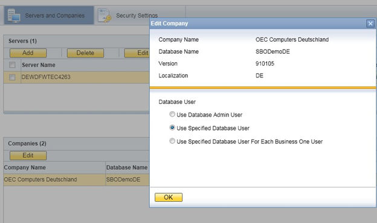

# Security Solutions for Microsoft SQL Server and Database Tips

- [Upgrading Microsoft SQL Server](#upgrading-microsoft-sql-server)
- [Securing Microsoft SQL Server](#securing-microsoft-sql-server)
- [Revoking Guest Access to the msdb Database](#revoking-guest-access-to-the-msdb-database)

We recommend that you take the following actions to ensure the security of your Microsoft SQL Server.

## Upgrading Microsoft SQL Server

We recommend upgrading the SQL server to the latest service pack. Furthermore, administrators should regularly consult the SQL Server Security Center at www.microsoft.com (https://www.microsoft.com).

> **Note**
>
> If the existing version of SAP Business One does not support the newer SQL version, you must upgrade SAP Business One before upgrading the Microsoft SQL Server.

For information about the upgrade sequence for Microsoft SQL Server, see the following documents:

- SAP Note 928839 (https://me.sap.com/notes/928839).
- "Hardware and Software Requirements for Installing SQL Server 2014 (https://msdn.microsoft.com/en-us/library/ms143506.aspx) " as stipulated by Microsoft® Corp.

## Securing Microsoft SQL Server

Since SAP Business One is a two-tier application, much of the application security depends on the database server security and on the authorization mechanism. Be aware that users can access the database using tools other than SAP Business One and, therefore, can modify the logon information. To secure your database, we recommend adhering to Microsoft security guidelines. For more information, see the Microsoft documents at www.microsoft.com (https://www.microsoft.com).

### Setting Up an Alternative Admin User

If you are using SQL authentication, when you register a database server in the SLD (9.0 and higher) or license server (release family 8.8), you need to specify a database admin user for the server. This alternative admin user can be used for creating and upgrading companies and performing other landscape management tasks in the SLD.

**Procedure**

To create an alternative admin user account for maintaining administration tasks for SAP Business One, do the following:

1. In Windows, choose *Start* > *All Programs* > *Microsoft SQL Server <Version>* > *SQL Server Management Studio*.
2. In the *SQL Server Management Studio Object Explorer* window, choose *Security* > *Logins*.
3. Right-click the *Logins* folder and choose *New Login*. The *Login - New* window appears.
4. On the *General* tab, select *SQL Server authentication* and enter a strong password.
5. On the *Server Roles* tab, select *sysadmin*.
6. Choose *OK*.

When you create a company database, we recommend that you enable the database user per company in SLD. To do so, perform the following:

1. Log in to the SLD service. For more information, see [Logging in to the System Landscape Directory Control Center](../system-landscape-directory/sld-overview-and-login.md#logging-in-to-the-system-landscape-directory-control-center) [page 85].
2. Select the appropriate server and company and then choose *Edit*.

Figure: The Edit Company window with the Use Specified Database User option selected.

3. In the *Edit Company* window, select the *Use Specified Database User* radio button. The SLD creates a database user for this company with the appropriate database roles, which is then used by the SAP Business One client to connect to the database.
4. Choose *OK*.

If you are using **Microsoft Windows authentication**, you must grant SAP Business One admin users the *sysadmin* and *public* server roles. When creating or upgrade companies, you must use this admin user to launch the SAP Business One client or setup wizard.

For normal SAP Business One users, you need to grant admin users the following roles:

- For the common database: *db_datawriter* and *db_datareader*
- For the company database: *db_owner*

> **Note**
>
> You cannot set up a local user that is not in the Active Directory.

## Revoking Guest Access to the msdb Database

**Procedure**

1. To open the SQL Server Management Studio, in Windows, choose *Start* > *All Programs* > *Microsoft SQL Server <Version>*.
2. In the *Connect to Server* window, specify values in the *Server name* and *Authentication* fields, and choose *Connect*.
3. In the window *SQL Server Management Studio Object Explorer*, choose *Databases* > *System Databases* > *msdb* > *Security* > *Users*.
4. In the structure, right-click the *Guest* user and choose *Delete*.
