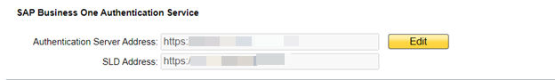
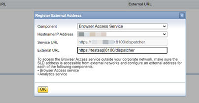

# Mapping External Addresses to Internal Addresses

To enable access from outside the local network, you must map an external access URL to each required component. For more information about how to enable external access to SAP Business One services, see [Enabling External Access to SAP Business One Services](../demo-databases-and-external-access/external-access/choosing-a-method.md) [page 129].

**Procedure**

1. Log in to the SLD control center `https://<Hostname>:<Port>/ControlCenter`.
2. On the *Security* tab, in the *SAP Business One Authentication Service* section, choose *Edit* and make the following changes:

Figure: The SAP Business One Authentication Service section of the Security tab.



> **Note**
>
> Make sure that you define a correct address for the SLD and authentication server. The whole SAP Business One landscape does not work if the address is incorrect.
>
> Make sure that the address is accessible to both internal and external networks. You can add a record in the DNS to make the address accessible for the internal networks.

- Change the existing authentication server address and port number to `https://<External B1AS domain name>:<External listening port number of B1AS>`, in this example, `https://ExternalAddress.def.com:8443` for the reverse proxy mode and `https://B1ASExternalAddress.abc.corp:Port` for the NAT/PAT mode.
- Change the existing SLD address and port number to `https://<External SLD domain name>:<External listening port number of SLD>`, in this example, `https://ExternalAddress.def.com:8443` for the reverse proxy mode and `https://SLDExternalAddress.abc.com:Port` for the NAT/PAT mode.

> **Note**
>
> If the reverse proxy is used, the address and port of the authentication server and SLD will be the same. In nginx configuration, they share the same port, According to their API names, nginx will dispatcher the request to SLD and authentication server. For more information about nginx configuration, see [Reverse Proxy Mode](../demo-databases-and-external-access/external-access/reverse-proxy-mode.md#reverse-proxy-mode) [page 132].
>
> If the SLD address is changed, the Extension Manager URL will change to `https://<External SLD domain name>:<External listening port number of SLD>/ExtensionManager`, as an example, `https://ExternalAddress.def.com:8443/ExtensionManager` for the reverse proxy mode and `https://SLDInternalAddress.abc.com:Port/ExtensionManager` for the NAT/PAT mode.

3. On the *External Address Mapping* tab, choose *Register*.
4. In the *Edit External Address* window, specify the following information for other components:
   - Component
   - Hostname or IP address of the machine on which the component is installed
   - External URL The external access URL must have the format `<protocol>://<Path>:<Port>`.

> **Example**
>
> ```text
> https://testsap:8100/dispatcher
> ```

Figure: The Edit External Address window.



The window shows the fields Component (here Browser Access Service), Hostname/IP Address, Service URL (here ending in `:8100/dispatcher`), and External URL (here `https://testsap:8100/dispatcher`), with an *OK* button. A note in the window says that, to access the Browser Access service outside the corporate network, the SLD address must be reachable from external networks and an external address must be configured for the Browser Access service and the Analytics service.


5. Choose *OK*.

**Post-requisites**

After finishing mapping the addresses for all required components, you must restart the services on the machines on which they're installed.

For example, if you have registered the external address mapping for a Browser Access server, you must restart the SAP Business One Browser Access Server Gatekeeper service.

> **Note**
>
> For the Web client, you need to restart the service by performing the following steps:
>
> 1. Run Windows PowerShell as the administrator.
> 2. Navigate to the Web client installation folder by entering `C:\Program Files\SAP\SAP Business One Web`.
> 3. Restart the setup program by entering the following command:
>
>    ```powershell
>    .\WebClientStartup.ps1 “restart”
>    ```
>
>    The restart process begins.
