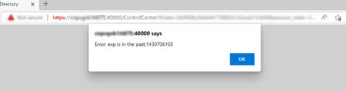
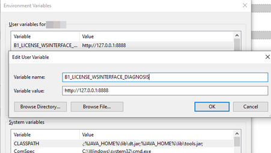
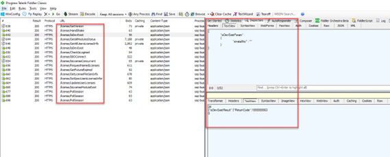

# Troubleshooting

- [Delay in Establishing a Connection with the License Service](#delay-in-establishing-a-connection-with-the-license-service)
- [Troubleshooting Service Layer Connection Problems](#troubleshooting-service-layer-connection-problems)
- [Web Client Windows Services Fails to Start](#web-client-windows-services-fails-to-start)
- [Time Synchronization Issue](#time-synchronization-issue)
- [Troubleshooting License Server Connectivity Issues](#troubleshooting-license-server-connectivity-issues)

## Delay in Establishing a Connection with the License Service

**Problem**

You have difficulty establishing a connection with the license service. This issue may lead to the workflow service not working (error message: "Failed to connect company from workflow service"). For more information, see SAP Note 1135705 (https://me.sap.com/notes/1135705).

**Solution 1**

1. Change the registry entry and add the IP address of the license server computer as follows:
   - For 32-bit operating systems: *HKEY_LOCAL_MACHINE\SOFTWARE\ACE\TAO*
   - For 64-bit operating systems: *HKEY_LOCAL_MACHINE\SOFTWARE\Wow6432Node\ACE\TAO*
2. Use the IP address instead of the computer name for the license server address where required, such as for the SAP Business One client, DI API, B1i, and so on.

**Solution 2**

1. In the Control Panel, disable additional network cards.
2. Ensure there is no dial-up interface or VPN interface configured.
3. Restart the server.

Note that you can re-enable the additional network card after restart. This will resolve the issue until the next restart.

## Troubleshooting Service Layer Connection Problems

If you cannot connect to the Service Layer, there may be problems with the load balancer or a balancer member. To identify the cause and fix the problem, do the following:

1. To access the balancer manager, in a Web browser, enter the following URL: `https://<Balancer Server Address>:<Port>/balancer-manager`
2. If you cannot access the balancer manager, log in to the load balancer machine as the administrator and restart the load balancer using the following command: `<Installation Folder>\ServiceLayer\b1s<Load Balancer Port>.bat restart`
3. In the balancer manager, check the status of each load balancer member. If a member is running abnormally, log in to the load balancer member machine as the administrator and restart the member using the following command: `<Installation Folder>\ServiceLayer\b1s<Load Balancer Member Port>.bat restart`
4. If you can access the balancer manager and the status of all load balancer members is OK, but you still cannot connect to the Service Layer, check the error log files on each machine on which Service Layer components are installed. The error log files are located under `<Installation Directory>\ServiceLayer\logs` with access log files and SSL request log files as below:
   - `access_<Load Balancer/Member Port>_log_<Date>`: Records the requests sent or distributed to the load balancer or the load balancer member.
   - `error_<Load Balancer/Member Port>_log_<Date>`: Records the errors which the Apache server encounters.
   - `ssl_<Load Balancer Port>_log_<Date>`: Records the SSL requests sent to the load balancer and is relevant only to the load balancer.

> **Note**
>
> The log format is defined by the corresponding Apache configuration file (`httpd-b1s-lb.conf` for the load balancer and `httpd-b1s-lb-member-<Port Number>.conf` for load balancer members), which is located under `<Load Balancer/Member Installation Folder>/ServiceLayer/conf`. For more information, see the documentation about the mod_log_config module at https://httpd.apache.org/docs.
>
> We recommend that users do **not** modify Apache configuration files. However, if you need to modify the configuration files, be aware of the following points:
>
> - After changing an Apache configuration file, you must restart the respective Service Layer component in order for the changes to take effect.
> - After you upgrade the Service Layer to a higher version, all changes made by you will be lost. On the contrary, changes made by tools such as the Service Layer configurator will be kept. For more information, see [Service Layer](../configuring-services/service-layer-configuration.md) [page 117] in the post-installation chapter.

If you want to restart all local Service Layer components (load balancer and load balancer members), use the following command:

```bash
<Installation Folder>\ServiceLayer\b1s.bat restart
```

The `start` and `stop` commands are also valid for the Service Layer. For example, `<Installation folder>\ServiceLayer\b1s.bat stop` stops all local Service Layer components.

## Web Client Windows Services Fails to Start

If you fail to start the Web client after it takes longer than usual to run the Web client Windows services, you may need to check the event log in the Windows *Event Viewer* (*Event Viewer* > *Event Viewer (Local)* > *Application* > *Event Log*). If the log informs you of the service exiting with return code `9911` (source: `nssm`), the probable cause is that the Service Layer and Web client lose the binding with the database instance in the System Landscape Directory (SLD) control center.

To solve the issue, do the following:

1. Log in to the SLD control center.
2. On the *Services* tab, make sure that the Service Layer and Web client are already bound to a database instance that is registered in the SLD control center. You can perform the following steps to add the database instance:
   1. Select *Service Layer* or *Web Client for SAP Business One* and choose *Edit*.
   2. In the *Edit Service* window, choose a valid service unit.
   3. Choose *OK*.
3. Restart the Web client.

## Time Synchronization Issue

If you fail to log in to the SLD control center with the following error message, you need to check the time synchronization between your client and the server where the SLD installed.

Figure: The SLD control center login error message dialog.



The browser dialog on the SLD control center page (port 40000) displays the error text `Error: exp is in the past:1430706103`.


## Troubleshooting License Server Connectivity Issues

You can also see Troubleshoot License Server Connectivity Issues.

**Problem**

Your end users encounter license server connectivity issues when they log in to the SAP Business One client.

As a support user, you need to help troubleshoot license server connectivity issues with a debugging tool.

**Solution**

As of SAP Business One 10.0 FP 2305, license server connectivity issues can be troubleshot by configuring a Windows environment variable and using a network troubleshooting tool.

Ask end users to do the following on their PCs:

1. Install a network troubleshooting tool, for example, Fiddler Classic.
2. Go to *Start* > *Settings*. Enter `Edit environment variables for your account` in the search box and open the *Environment Variables* window.
3. Add a new variable for the current user: `B1_LICENSE_WSINTERFACE_DIAGNOSIS`. Enter Fiddler's proxy address as the variable value. The default is `http://127.0.0.1:8888`.

   Figure: The Environment Variables window with the new user variable defined in the Edit User Variable dialog.

   

4. Restart the PC for the changes to take effect.
5. Open Fiddler Classic first. Then log in to the SAP Business One client as the current end user usually does. The client's network traffic to the license server shows up in Fiddler Classic as below. Now you can diagnose network issues with the information.

   Figure: Fiddler Classic showing the client's network traffic to the license server.

   

6. Save the sessions for analysis.
7. In order for SAP Business One to function properly, please don't forget to remove the variable `1_LICENSE_WSINTERFACE_DIAGNOSIS` from the environment variables settings after the analysis.
